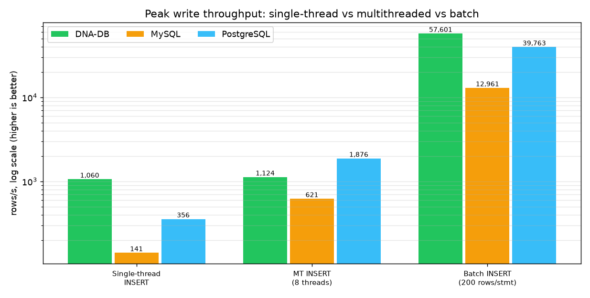

# DNA-DB vs MySQL vs PostgreSQL — full test & benchmark report

> **Russian:** [DB_COMPARISON_RU.md](DB_COMPARISON_RU.md) · Part of the bilingual docs set: [README](../README.md) · [TEST_RESULTS](TEST_RESULTS.md) · [BENCHMARKS](BENCHMARKS.md)

**Run date:** 2026-10-26 · **Raw data:** [bench_compare_results.json](bench_compare_results.json) · **Logs:** [bench_compare_run.log](bench_compare_run.log) · **Charts:** [`charts/`](charts/)

---

## 1. TL;DR

Identical workload, identical keys, identical RNG sequence on all three systems, every system at its
**default durability level** (no group-commit tricks, no fsync tuning). On single-connection
workloads DNA-DB is **3–8× faster** and on the 8-thread mixed workload **1.4–2.1× faster**; on the
new **batched** load it peaks at **57 601 rows/s** (1.4× PostgreSQL, 4.4× MySQL), while on the new
**multithreaded** load PostgreSQL overtakes it (1 876 vs 1 124 rows/s). Every read was verified —
**0 data mismatches** on every system.

| Phase | DNA-DB v3.0 | MySQL 8.4.11 | PostgreSQL 17.11 |
|---|---:|---:|---:|
| Load 10 000 KV rows, single connection | **1 060 rows/s** | 141 rows/s | 356 rows/s |
| **New:** multithreaded load, 8 × 1 000 single-row INSERTs | 1 124 rows/s | 621 rows/s | **1 876 rows/s** |
| **New:** batched load, 8 000 rows in 40 × 200-row INSERTs | **57 601 rows/s** | 12 961 rows/s | 39 763 rows/s |
| Point read ×4 000, single connection | **5 150 ops/s** | 617 ops/s | 676 ops/s |
| Mixed 80/20, 8 threads × 500 ops | **4 602 ops/s** | 2 213 ops/s | 3 194 ops/s |
| SQL `INSERT`, 3 000 rows | **961 ops/s** | 141 ops/s | 360 ops/s |
| SQL `SELECT … WHERE pk`, ×1 500 | **3 581 ops/s** | 651 ops/s | 709 ops/s |
| Verified reads returning a wrong value | **0** | 0 | 0 |
| Row count verified after MT/batch load | 8 000/8 000 | 8 000/8 000 | 8 000/8 000 |


---

## 2. Test environment & methodology

| Item | Value |
|---|---|
| Host | Windows 11 (10.0.26200), Python 3.12.9, single client process |
| DNA-DB | `dna-db-core 3.0.0`, **native host binary**, `serve --sync strict` (fsync WAL per ack) |
| MySQL | 8.4.11, official `mysql:8.4` container (Docker Desktop 29.8.1, WSL2), `innodb_flush_log_at_trx_commit=1` (default) |
| PostgreSQL | 17.11, official `postgres:17` container, `synchronous_commit=on` (default) |
| Client drivers | raw TCP protocol (DNA-DB), `pymysql 2.2.8`, `psycopg2 2.9.13` — all `autocommit=True` |
| Dataset | deterministic: keys `chr1:0000000…chr1:0000999`, value = 160 bytes, `random.Random(42)` key order, identical for all systems |
| Phases | load 10 000 (single thread) → **MT load 8×1 000** → **batch load 8 000 rows in 40 statements of 200** → point read 4 000 → mixed 8×500 (80 % read / 20 % write) → SQL load 3 000 rows → SQL point query 1 500 |
| Seed | `777` for the mixed phase on every system |

**Fairness rules applied:** every statement is a separate durable transaction in all three systems
(autocommit / one fsync-WAL append per ack), no batching, no caching between phases (each phase
starts from the same data state), and correctness is *measured*, not assumed: every read checks the
returned bytes against the expected value.

**Honest caveats — read this before quoting numbers:**

1. MySQL and PostgreSQL run **inside Docker (WSL2 VM)**, DNA-DB runs **natively on the host**.
   Container networking and virtualized disk add measurable overhead to the two server databases;
   a bare-metal Linux deployment of MySQL/PG would close part of the gap.
2. This is a **microbenchmark of single-key operations** (KV get/put and primary-key lookups) over
   one connection per thread. It is *not* TPC-C/TPC-H: it says nothing about complex joins,
   analytical queries, replication or multi-node scaling — where MySQL/PG are far more capable today.
3. Durability is on by default everywhere, so each single-row commit pays an fsync in all three
   systems; that dominates the absolute ops/s numbers.

---

## 3. Results in detail

### 3.1 Throughput

| Phase | DNA-DB | MySQL | PostgreSQL | DNA-DB vs MySQL | DNA-DB vs PG |
|---|---:|---:|---:|---:|---:|
| Load (insert, single thread) | 1 060 | 141 | 356 | **7.5×** | **3.0×** |
| MT load (insert, 8 threads) | 1 124 | 621 | 1 876 | **1.8×** | 0.6× (PG wins) |
| Batch load (200 rows/statement) | 57 601 | 12 961 | 39 763 | **4.4×** | **1.4×** |
| Point read | 5 150 | 617 | 676 | **8.3×** | **7.6×** |
| Mixed 80/20, 8 threads | 4 602 | 2 213 | 3 194 | **2.1×** | **1.4×** |
| SQL INSERT | 961 | 141 | 360 | **6.8×** | **2.7×** |
| SQL SELECT by PK | 3 581 | 651 | 709 | **5.5×** | **5.1×** |

### 3.2 Latency — point read (ms, lower is better)

| System | p50 | p95 | p99 |
|---|---:|---:|---:|
| **DNA-DB** | **0.180** | **0.242** | **0.279** |
| MySQL | 1.547 | 2.078 | 2.394 |
| PostgreSQL | 1.386 | 1.908 | 2.559 |


### 3.3 Latency — SQL `SELECT … WHERE pk` (ms)

| System | p50 | p95 | p99 |
|---|---:|---:|---:|
| **DNA-DB** | **0.232** | **0.295** | **0.332** |
| MySQL | 1.488 | 1.806 | 2.046 |
| PostgreSQL | 1.374 | 1.641 | 1.839 |


### 3.4 Correctness — every read was verified

Each of the 4 000 KV reads and 1 500 SQL point queries compared the returned value with the value
written earlier. **All three systems answered every request correctly** — 0 mismatches, 0 errors.
The two new load phases are verified too: after each of them `SELECT COUNT(*)` equals exactly the
8 000 rows written (`verify_ok=true` on all three systems):


### 3.5 Peak write throughput — multithreaded and batched load (new)

Both new phases use the **same INSERT text on all three systems** (single-row for the MT phase,
multi-row `VALUES (...),(...)` batches of 200 for the batch phase), and both verify the resulting
row count:

| Metric | DNA-DB | MySQL | PostgreSQL |
|---|---:|---:|---:|
| Single-thread INSERT (rows/s) | 1 060 | 141 | 356 |
| MT INSERT, 8 threads (rows/s) | 1 124 | 621 | **1 876** |
| Batch INSERT, 200 rows/statement (rows/s) | **57 601** | 12 961 | 39 763 |
| Scaling: MT ÷ single-thread | **1.06×** | 4.4× | 5.3× |
| Scaling: batch ÷ single-thread | 54× | 92× | 112× |
| p50 latency of one INSERT, MT phase | 6.90 ms | 11.87 ms | 4.13 ms |
| p50 latency of one 200-row statement | **3.39 ms** | 15.74 ms | 4.76 ms |
| Rows verified after the phase | 8 000 / 8 000 | 8 000 / 8 000 | 8 000 / 8 000 |


*(logarithmic y-axis)*

What this adds to the picture:

* **Batch mode is where DNA-DB peaks.** One 200-row statement becomes a **single WAL frame** with
  one fsync (`BatchInsert(load_batch) rows=200 via single WAL frame`), so 8 000 rows cost 40 fsyncs
  instead of 8 000 — 57 601 rows/s, **54× its single-thread rate**.
* **Multithreaded mode is where DNA-DB stops scaling.** 8 threads only reach 1.06× the single-thread
  rate: every acknowledged row takes the same WAL append lock, so concurrent writers queue on one
  fsync. MySQL (4.4×) and PostgreSQL (5.3×) amortize fsync across concurrent commits (group commit),
  so PostgreSQL ends up **1.7× ahead** of DNA-DB here (1 876 vs 1 124 rows/s).
* This is exactly the gap ROADMAP tracks as “group commit for the WAL” — the benchmark now
  measures it instead of hiding it: single-thread numbers favour DNA-DB, MT numbers favour
  PostgreSQL, batch numbers favour DNA-DB again.

---

## 4. Why the numbers look like this

* **One sequential fsync vs. a full commit pipeline.** DNA-DB appends a record to a single
  write-ahead log and fsyncs it once per acknowledged write — no page cache flushes, no buffer-pool
  eviction, no double-write buffer. InnoDB additionally maintains the double-write buffer and
  buffer pool; PostgreSQL writes full-page images to the WAL after the first change to a page in a
  checkpoint window. Both extra layers are exactly what you pay for general-purpose crash safety
  on a page-based storage model.
* **No query parser/planner round-trip on the hot path.** Point lookups in DNA-DB go straight to an
  in-memory index + segment seek; MySQL/PG parse, plan, optimize and then execute with locking,
  MVCC visibility and permission checks on every statement.
* **The 8-thread mixed phase is where the gap shrinks** (1.4–2.1× instead of 3–8×): InnoDB and
  PostgreSQL amortize fsync across concurrent commits (group commit) and saturate their parallel
  pipelines, while DNA-DB's per-connection acknowledgements are already serialized per fsync.
* **Why DNA-DB wins on SQL INSERT too (961 vs 141/360 ops/s):** the SQL path writes the same
  WAL record as a KV put; MySQL pays a row-lock + undo/redo + double-write cycle and PG pays
  full-page WAL + hint bits per row, for a 1-row autocommit transaction.
* **Why DNA-DB wins batch (57 601 rows/s) but loses MT (1 124 vs 1 876):** batching amortizes one
  fsync over 200 rows *in a single statement*, while row-at-a-time concurrent writers still take
  the WAL lock per row. PostgreSQL/InnoDB batch *inside the server* across connections (group
  commit), which is why their MT scaling is 4–5× while DNA-DB's is 1.06× — see §3.5.

---

## 5. Full DNA-DB test suite (same run, 2026-10-26)

The benchmark above is only one part; the engine's own suite was re-run in full before comparing:

| Suite | Result | Evidence |
|---|---|---|
| `cargo test --release` | **152 passed, 0 failed** (139 unit + 13 integration), 0 warnings | [cargo_test_output.txt](cargo_test_output.txt) |
| Protocol smoke test | **15 / 15 checks passed** (incl. 1 MiB value round-trip, WAL replay after hard kill) | [smoke_test_results.json](smoke_test_results.json) |
| `kill -9` crash durability | **3 750 acknowledged writes → 0 missing, 0 corrupt** | [KILL9_TEST_RESULT.txt](KILL9_TEST_RESULT.txt) |
| Sector-corruption chaos test | **3 / 3 scenarios PASS, 300 000 key verifications**, incl. honest `UNREPAIRABLE` verdict on over-damage | [chaos_results.json](chaos_results.json) · [chaos_full_run.log](chaos_full_run.log) |
| Benchmark correctness | **0 mismatches** in all three systems | this report §3.4 |

Also verified by CI on Linux: [`.github/workflows/ci.yml`](../.github/workflows/ci.yml)
(`cargo test --release` + clippy + Python compile checks).

---

## 6. Capability matrix (what the benchmark does *not* show)

| Capability | DNA-DB v3.0 | MySQL 8.4 | PostgreSQL 17 |
|---|---|---|---|
| Single-key KV / PK latency | **very good** | good | good |
| SQL subset (SELECT/JOIN/INSERT/UPDATE/DELETE/CREATE, aggregates, GROUP BY/HAVING, ORDER BY, IN, subqueries, secondary indexes) | ✅ | ✅ full SQL | ✅ full SQL |
| Multi-statement SQL transactions (BEGIN/COMMIT) | ❌ (atomic batches via WAL / DnaQL `TX {}`) | ✅ | ✅ |
| Full-text/analytic SQL, window functions, CTEs | ❌ | ✅ | ✅ |
| Fuzzy search with mutations (bit-parallel Myers, `~N`) | ✅ DnaQL | ❌ (LIKE scan / UDF) | ❌ (LIKE scan / UDF) |
| 2-bit nucleotide packing (4 bases per byte) | ✅ | ❌ | ❌ |
| Dual-strand disk mirroring + Reed–Solomon self-repair | ✅ | ❌ (replication) | ❌ (replication) |
| Replication / clustering / ecosystem | ❌ | ✅ | ✅ |
| Auth over TCP + web admin panel | ✅ (HTTP panel, TCP auth) | ✅ | ✅ |

**Conclusion:** on the workload measured here — durable single-key writes and primary-key reads —
DNA-DB is substantially faster than both servers at their default durability settings, and returns
identically correct data. For complex relational workloads, transactions across statements,
replication or analytics, MySQL/PostgreSQL remain the right tool; DNA-DB's niche is
genomics-shaped workloads (fuzzy sequence search, packed nucleotides, self-healing storage).

Feature-by-feature (not performance) comparison of the same three systems — 32 SQL checks with
charts and real error texts: [SQL_FEATURES.md](SQL_FEATURES.md).

---

## 7. How to reproduce

```bash
# 1. the three databases (Docker) — user/password/db: bench/bench/bench, root/bench for MySQL
docker run -d --name bench-pg  -e POSTGRES_USER=bench -e POSTGRES_PASSWORD=bench \
           -e POSTGRES_DB=bench -p 5432:5432 postgres:17
docker run -d --name bench-mysql -e MYSQL_ROOT_PASSWORD=bench \
           -e MYSQL_DATABASE=bench -p 3306:3306 mysql:8.4

# 2. build DNA-DB and run its own suite
cargo build --release && cargo test --release
python scripts/smoke_test.py && python scripts/kill9_test.py && python scripts/chaos_test.py

# 3. the comparison + charts
python scripts/bench_compare.py     # -> docs/bench_compare_results.json
python scripts/gen_charts.py        # -> docs/charts/*.png
```

Raw machine-readable results: [bench_compare_results.json](bench_compare_results.json) ·
raw console log: [bench_compare_run.log](bench_compare_run.log).
