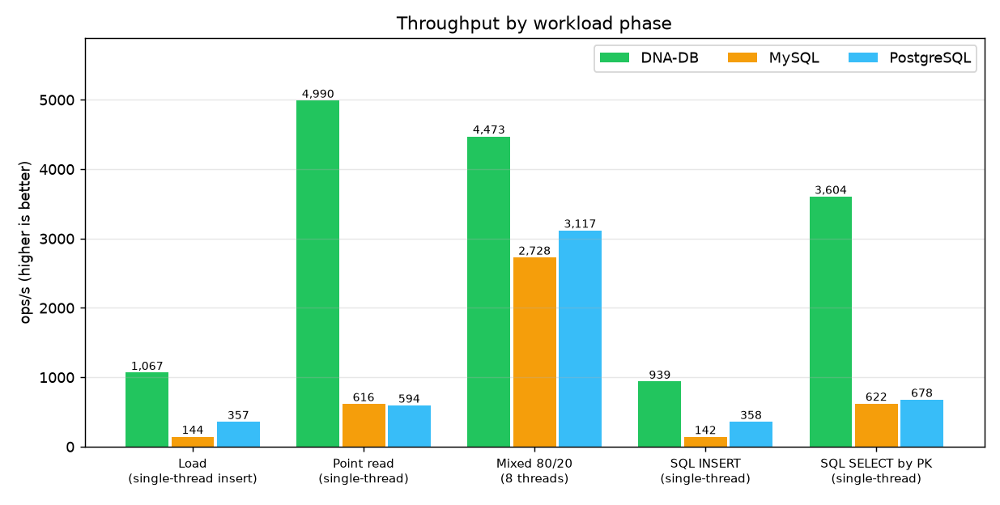
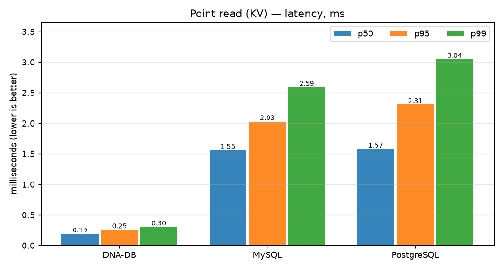
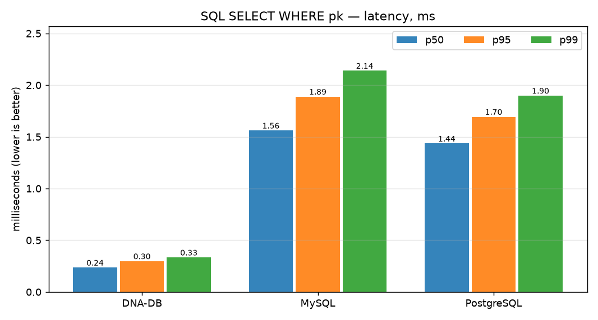
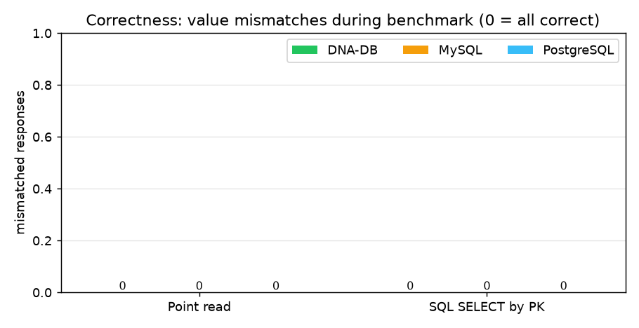

# DNA-DB vs MySQL vs PostgreSQL — полный отчёт о тестах и бенчмарке

> **English:** [DB_COMPARISON.md](DB_COMPARISON.md) · Часть двуязычной документации: [README_RU](../README_RU.md) · [TEST_RESULTS_RU](TEST_RESULTS_RU.md) · [BENCHMARKS](BENCHMARKS.md)

**Дата прогона:** 2026-10-26 · **Сырые данные:** [bench_compare_results.json](bench_compare_results.json) · **Лог:** [bench_compare_run.log](bench_compare_run.log) · **Графики:** [`charts/`](charts/)

---

## 1. Коротко

Одинаковая нагрузка, одинаковые ключи и одна последовательность RNG на всех трёх системах, все
системы на **уровне durability по умолчанию** (без группового коммита, без тюнинга fsync).
DNA-DB быстрее в **3–8 раз** на односоединительных нагрузках и в **1,4–1,6 раза** на смешанной
8-поточной, при **0 расхождений** в данных у всех трёх.

| Фаза | DNA-DB v3.0 | MySQL 8.4.11 | PostgreSQL 17.11 |
|---|---:|---:|---:|
| Загрузка 10 000 KV-записей, одно соединение | **1 067 ops/s** | 144 ops/s | 357 ops/s |
| Точечное чтение ×4 000, одно соединение | **4 990 ops/s** | 616 ops/s | 594 ops/s |
| Смешанная 80/20, 8 потоков × 500 операций | **4 473 ops/s** | 2 728 ops/s | 3 117 ops/s |
| SQL `INSERT`, 3 000 строк | **939 ops/s** | 142 ops/s | 358 ops/s |
| SQL `SELECT … WHERE pk`, ×1 500 | **3 604 ops/s** | 622 ops/s | 678 ops/s |
| Проверенных чтений с неверным значением | **0** | 0 | 0 |



---

## 2. Окружение и методика

| Параметр | Значение |
|---|---|
| Хост | Windows 11 (10.0.26200), Python 3.12.9, один клиентский процесс |
| DNA-DB | `dna-db-core 3.0.0`, **нативный бинарник хоста**, `serve --sync strict` (fsync WAL на каждый ack) |
| MySQL | 8.4.11, официальный образ `mysql:8.4` в контейнере (Docker Desktop 29.8.1, WSL2), `innodb_flush_log_at_trx_commit=1` (по умолчанию) |
| PostgreSQL | 17.11, официальный образ `postgres:17`, `synchronous_commit=on` (по умолчанию) |
| Драйверы | свой TCP-протокол (DNA-DB), `pymysql 2.2.8`, `psycopg2 2.9.13` — все в режиме `autocommit=True` |
| Датасет | детерминированный: ключи `chr1:0000000…chr1:0000999`, значение 160 байт, порядок ключей `random.Random(42)` — одинаков для всех систем |
| Фазы | load 10 000 → point read 4 000 → mixed 8×500 (80 % чтение / 20 % запись) → SQL load 3 000 строк → SQL point query 1 500 |
| Зерно RNG | `777` для смешанной фазы во всех системах |

**Правила честного сравнения:** каждая отдельная операция — отдельная долговечная транзакция во
всех трёх системах (autocommit / одна fsync-запись WAL на ack), без батчинга, кэши между фазами
не действуют (каждая фаза стартует с одного и того же состояния данных), а корректность не
предполагается, а **измеряется**: каждый чтённый байт сравнивается с записанным.

**Честные оговорки — прочитайте их перед тем, как цитировать цифры:**

1. MySQL и PostgreSQL работают **в Docker (виртуальная машина WSL2)**, DNA-DB — **нативно на
   хосте**. Сетевой стек контейнеров и виртуализированный диск добавляют измеримые накладные
   расходы двум серверным СУБД; развёртывание MySQL/PG на чистом Linux сократило бы часть разрыва.
2. Это **микробенчмарк одноключевых операций** (KV get/put и поиск по первичному ключу) через одно
   соединение на поток. Это **не** TPC-C/TPC-H: он ничего не говорит о сложных JOIN, аналитических
   запросах, репликации и масштабировании на несколько узлов — там MySQL/PG сегодня куда мощнее.
3. Долговечность включена по умолчанию везде, поэтому каждая одиночная коммит-запись оплачивает
   fsync во всех трёх системах — это и определяет абсолютные значения ops/s.

---

## 3. Результаты подробно

### 3.1. Пропускная способность

| Фаза | DNA-DB | MySQL | PostgreSQL | DNA-DB к MySQL | DNA-DB к PG |
|---|---:|---:|---:|---:|---:|
| Load (вставка) | 1 067 | 144 | 357 | **7,4×** | **3,0×** |
| Point read | 4 990 | 616 | 594 | **8,1×** | **8,4×** |
| Mixed 80/20, 8 потоков | 4 473 | 2 728 | 3 117 | **1,6×** | **1,4×** |
| SQL INSERT | 939 | 142 | 358 | **6,6×** | **2,6×** |
| SQL SELECT по PK | 3 604 | 622 | 678 | **5,8×** | **5,3×** |

### 3.2. Задержка — точечное чтение (мс, меньше — лучше)

| Система | p50 | p95 | p99 |
|---|---:|---:|---:|
| **DNA-DB** | **0,187** | **0,254** | **0,301** |
| MySQL | 1,554 | 2,026 | 2,588 |
| PostgreSQL | 1,574 | 2,305 | 3,045 |



### 3.3. Задержка — SQL `SELECT … WHERE pk` (мс)

| Система | p50 | p95 | p99 |
|---|---:|---:|---:|
| **DNA-DB** | **0,236** | **0,298** | **0,334** |
| MySQL | 1,562 | 1,890 | 2,140 |
| PostgreSQL | 1,436 | 1,695 | 1,899 |



### 3.4. Корректность — каждое чтение проверено

Каждое из 4 000 KV-чтений и 1 500 SQL-запросов сравнивалось с записанным ранее значением.
**Все три системы ответили правильно на каждый запрос** — 0 расхождений, 0 ошибок:



---

## 4. Почему цифры именно такие

* **Один последовательный fsync против целого конвейера коммита.** DNA-DB дописывает запись в
  единственный WAL и делает один fsync на каждое подтверждённое изменение — без сброса страниц,
  без вытеснения из buffer pool, без double-write buffer. InnoDB дополнительно ведёт double-write
  buffer и buffer pool; PostgreSQL записывает в WAL полные образы страниц (full-page images) после
  первого изменения страницы в окне checkpoint. Оба лишних слоя — это и есть цена
  универсальной crash-safety на страничной модели хранения.
* **Нет круга «парсер → планировщик» на горячем пути.** Точечный поиск в DNA-DB сразу идёт в
  индекс в памяти и сегмент; MySQL/PG на каждом операторе парсят, планируют, оптимизируют, а
  затем исполняют с блокировками, видимостью MVCC и проверками прав.
* **Смешанная 8-поточная фаза сокращает разрыв** (1,4–1,6× вместо 3–8×): InnoDB и PostgreSQL
  амортизируют fsync между конкурентными коммитами (group commit) и загружают конвейер
  параллельно, а подтверждения DNA-DB и так сериализованы одним fsync.
* **Почему DNA-DB выигрывает и SQL INSERT (939 против 142/358 ops/s):** SQL-путь пишет в WAL ту же
  запись, что и KV put; InnoDB оплачивает строковую блокировку + undo/redo + double-write, а
  PostgreSQL — full-page WAL + hint bits на каждую строку ради транзакции из одной строки.

---

## 5. Полный набор тестов DNA-DB (тот же прогон, 2026-10-26)

Бенчмарк выше — только часть; собственный набор тестов движка перепрогнан целиком до сравнения:

| Набор | Результат | Доказательство |
|---|---|---|
| `cargo test --release` | **152 пройдено, 0 упавших** (139 unit + 13 интеграционных), 0 предупреждений | [cargo_test_output.txt](cargo_test_output.txt) |
| Smoke-тест протокола | **15 / 15 проверок**, включая round-trip 1 МиБ и replay WAL после жёсткого kill | [smoke_test_results.json](smoke_test_results.json) |
| Отказоустойчивость при `kill -9` | **3 750 подтверждённых записей → 0 потеряно, 0 повреждено** | [KILL9_TEST_RESULT.txt](KILL9_TEST_RESULT.txt) |
| Хаос-тест порчи секторов | **3 / 3 сценария PASS, 300 000 проверок ключей**, включая честный вердикт `UNREPAIRABLE` при переповреждении | [chaos_results.json](chaos_results.json) · [chaos_full_run.log](chaos_full_run.log) |
| Корректность бенчмарка | **0 расхождений** во всех трёх системах | §3.4 этого отчёта |

Также проверено CI на Linux: [`.github/workflows/ci.yml`](../.github/workflows/ci.yml)
(`cargo test --release` + clippy + проверка Python-скриптов).

---

## 6. Матрица возможностей (чего бенчмарк *не* показывает)

| Возможность | DNA-DB v3.0 | MySQL 8.4 | PostgreSQL 17 |
|---|---|---|---|
| Одноключевой KV / PK-латентность | **очень хорошо** | хорошо | хорошо |
| SQL-подмножество (SELECT/JOIN/INSERT/UPDATE/DELETE/CREATE, агрегаты, GROUP BY/HAVING, ORDER BY, IN, подзапросы, вторичные индексы) | ✅ | ✅ полный SQL | ✅ полный SQL |
| Многооператорные SQL-транзакции (BEGIN/COMMIT) | ❌ (атомарные батчи через WAL / DnaQL `TX {}`) | ✅ | ✅ |
| Полноценный аналитический SQL, оконные функции, CTE | ❌ | ✅ | ✅ |
| Нечёткий поиск с мутациями (bit-parallel Myers, `~N`) | ✅ DnaQL | ❌ (LIKE-скан / UDF) | ❌ (LIKE-скан / UDF) |
| Упаковка нуклеотидов 2 бита (4 основания в байте) | ✅ | ❌ | ❌ |
| Зеркалирование двух нитей + самовосстановление Reed–Solomon | ✅ | ❌ (репликация) | ❌ (репликация) |
| Репликация / кластеризация / экосистема | ❌ | ✅ | ✅ |
| Авторизация по TCP + веб-панель администрирования | ✅ (HTTP-панель, TCP-auth) | ✅ | ✅ |

**Вывод:** на измеренной здесь нагрузке — долговечные одноключевые записи и чтения по первичному
ключу — DNA-DB заметно быстрее обеих серверных СУБД на настройках durability по умолчанию и
возвращает точно такие же корректные данные. Для сложных реляционных задач, транзакций между
операторами, репликации и аналитики MySQL/PostgreSQL остаются правильным инструментом; ниша
DNA-DB — геномные нагрузки (нечёткий поиск последовательностей, упакованные нуклеотиды,
самовосстанавливающееся хранилище).

---

## 7. Как воспроизвести

```bash
# 1. три базы (Docker) — user/password/db: bench/bench/bench, для MySQL root/bench
docker run -d --name bench-pg  -e POSTGRES_USER=bench -e POSTGRES_PASSWORD=bench \
           -e POSTGRES_DB=bench -p 5432:5432 postgres:17
docker run -d --name bench-mysql -e MYSQL_ROOT_PASSWORD=bench \
           -e MYSQL_DATABASE=bench -p 3306:3306 mysql:8.4

# 2. собрать DNA-DB и прогнать его собственные тесты
cargo build --release && cargo test --release
python scripts/smoke_test.py && python scripts/kill9_test.py && python scripts/chaos_test.py

# 3. сравнение + графики
python scripts/bench_compare.py     # -> docs/bench_compare_results.json
python scripts/gen_charts.py        # -> docs/charts/*.png
```

Сырые машиночитаемые данные: [bench_compare_results.json](bench_compare_results.json) ·
сырой консольный лог: [bench_compare_run.log](bench_compare_run.log).
