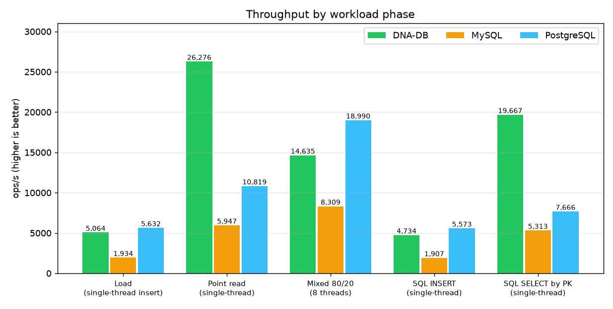
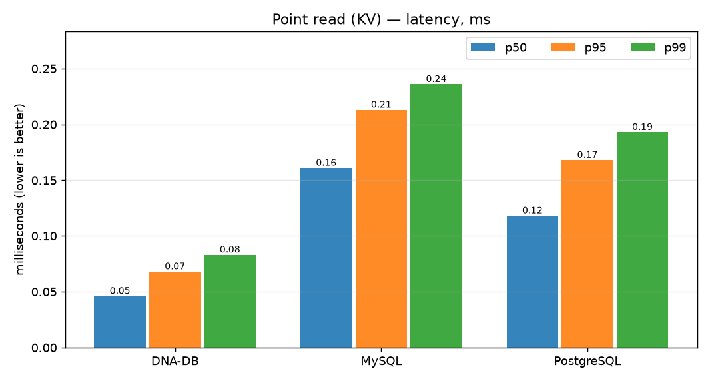
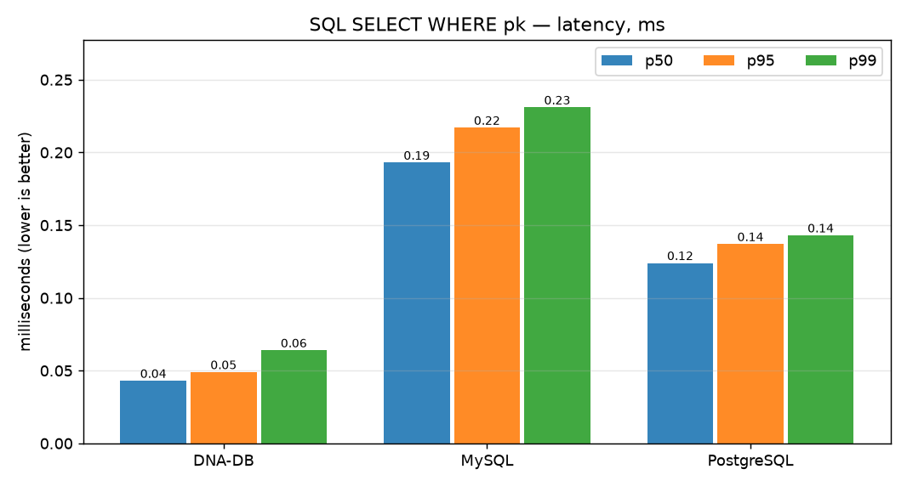
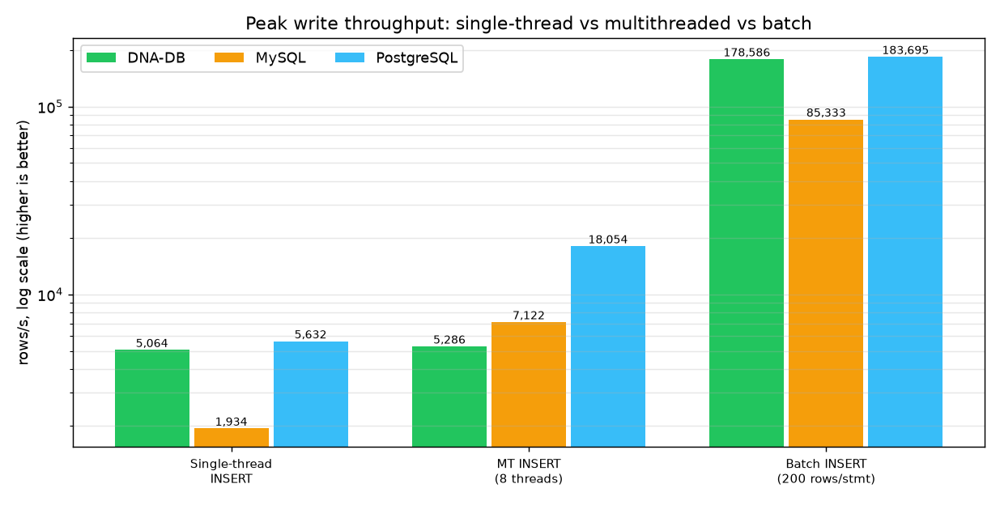
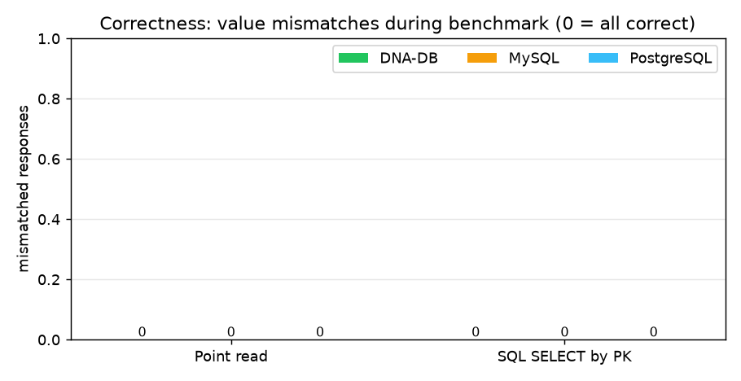

# DNA-DB vs MySQL vs PostgreSQL — полный отчёт о тестах и бенчмарке

> **English:** [DB_COMPARISON.md](DB_COMPARISON.md) · Часть двуязычной документации: [README_RU](../README_RU.md) · [TEST_RESULTS_RU](TEST_RESULTS_RU.md) · [BENCHMARKS](BENCHMARKS.md)

**Дата прогона:** 2026-10-26 · **Сырые данные:** [bench_compare_results.json](bench_compare_results.json) · **Лог:** [bench_compare_run.log](bench_compare_run.log) · **Графики:** [`charts/`](charts/)

> ✅ **Повторный прогон на нативном Linux (GitHub Actions, без контейнеров): см. §8 ниже.**
> apt MySQL 8.0.46 / PostgreSQL 16.15 на `ubuntu-latest` ·
> [bench_compare_results_linux.json](bench_compare_results_linux.json) · [bench_linux_run.log](bench_linux_run.log) · [графики `charts/linux/`](charts/linux/)

---

## 1. Коротко

Одинаковая нагрузка, одинаковые ключи и одна последовательность RNG на всех трёх системах, все
системы на **уровне durability по умолчанию** (без группового коммита, без тюнинга fsync).
На односоединительных нагрузках DNA-DB быстрее в **3–8 раз**, на смешанной 8-поточной — в
**1,4–2,1 раза**, на новой **пакетной** загрузке достигает **57 601 rows/s** (в 1,4 раза быстрее
PostgreSQL и в 4,4 — MySQL), а на новой **многопоточной** загрузке PostgreSQL обгоняет его
(1 876 против 1 124 rows/s). Каждое чтение проверено — **0 расхождений** у всех трёх.

| Фаза | DNA-DB v3.0 | MySQL 8.4.11 | PostgreSQL 17.11 |
|---|---:|---:|---:|
| Загрузка 10 000 KV-записей, одно соединение | **1 060 rows/s** | 141 rows/s | 356 rows/s |
| **Новое:** многопоточная загрузка, 8 × 1 000 одиночных INSERT | 1 124 rows/s | 621 rows/s | **1 876 rows/s** |
| **Новое:** пакетная загрузка, 8 000 строк в 40 INSERT по 200 | **57 601 rows/s** | 12 961 rows/s | 39 763 rows/s |
| Точечное чтение ×4 000, одно соединение | **5 150 ops/s** | 617 ops/s | 676 ops/s |
| Смешанная 80/20, 8 потоков × 500 операций | **4 602 ops/s** | 2 213 ops/s | 3 194 ops/s |
| SQL `INSERT`, 3 000 строк | **961 ops/s** | 141 ops/s | 360 ops/s |
| SQL `SELECT … WHERE pk`, ×1 500 | **3 581 ops/s** | 651 ops/s | 709 ops/s |
| Проверенных чтений с неверным значением | **0** | 0 | 0 |
| Сверено строк после MT/пакетной загрузки | 8 000/8 000 | 8 000/8 000 | 8 000/8 000 |


---

## 2. Окружение и методика

| Параметр | Значение |
|---|---|
| Хост | Windows 11 (10.0.26200), Python 3.12.9, один клиентский процесс |
| DNA-DB | `dna-db-core 3.0.0`, **нативный бинарник хоста**, `serve --sync strict` (fsync WAL на каждый ack) |
| MySQL | 8.4.11, официальный образ `mysql:8.4` в контейнере (Docker Desktop 29.8.1, WSL2), `innodb_flush_log_at_trx_commit=1` (по умолчанию) |
| PostgreSQL | 17.11, официальный образ `postgres:17`, `synchronous_commit=on` (по умолчанию) |
| Драйверы | свой TCP-протокол (DNA-DB), `pymysql 2.2.8`, `psycopg2 2.9.13` — все в режиме `autocommit=True` |
| Датасет | детерминированный: ключи `chr1:0000000…chr1:0000999`, значение 160 байт, порядок ключей `random.Random(42)` — одинаков для всех систем |
| Фазы | load 10 000 (один поток) → **MT-загрузка 8×1 000** → **пакетная загрузка 8 000 строк в 40 операторов по 200** → point read 4 000 → mixed 8×500 (80 % чтение / 20 % запись) → SQL load 3 000 строк → SQL point query 1 500 |
| Зерно RNG | `777` для смешанной фазы во всех системах |

**Правила честного сравнения:** каждая отдельная операция — отдельная долговечная транзакция во
всех трёх системах (autocommit / одна fsync-запись WAL на ack), без батчинга, кэши между фазами
не действуют (каждая фаза стартует с одного и того же состояния данных), а корректность не
предполагается, а **измеряется**: каждый чтённый байт сравнивается с записанным.

**Честные оговорки — прочитайте их перед тем, как цитировать цифры:**

1. MySQL и PostgreSQL работают **в Docker (виртуальная машина WSL2)**, DNA-DB — **нативно на
   хосте**. Сетевой стек контейнеров и виртуализированный диск добавляют измеримые накладные
   расходы двум серверным СУБД; развёртывание MySQL/PG на чистом Linux сократило бы часть разрыва.
2. Это **микробенчмарк одноключевых операций** (KV get/put и поиск по первичному ключу) через одно
   соединение на поток. Это **не** TPC-C/TPC-H: он ничего не говорит о сложных JOIN, аналитических
   запросах, репликации и масштабировании на несколько узлов — там MySQL/PG сегодня куда мощнее.
3. Долговечность включена по умолчанию везде, поэтому каждая одиночная коммит-запись оплачивает
   fsync во всех трёх системах — это и определяет абсолютные значения ops/s.

---

## 3. Результаты подробно

### 3.1. Пропускная способность

| Фаза | DNA-DB | MySQL | PostgreSQL | DNA-DB к MySQL | DNA-DB к PG |
|---|---:|---:|---:|---:|---:|
| Load (вставка, один поток) | 1 060 | 141 | 356 | **7,5×** | **3,0×** |
| MT-загрузка (вставка, 8 потоков) | 1 124 | 621 | 1 876 | **1,8×** | 0,6× (выигрывает PG) |
| Пакетная загрузка (200 строк/оператор) | 57 601 | 12 961 | 39 763 | **4,4×** | **1,4×** |
| Point read | 5 150 | 617 | 676 | **8,3×** | **7,6×** |
| Mixed 80/20, 8 потоков | 4 602 | 2 213 | 3 194 | **2,1×** | **1,4×** |
| SQL INSERT | 961 | 141 | 360 | **6,8×** | **2,7×** |
| SQL SELECT по PK | 3 581 | 651 | 709 | **5,5×** | **5,1×** |

### 3.2. Задержка — точечное чтение (мс, меньше — лучше)

| Система | p50 | p95 | p99 |
|---|---:|---:|---:|
| **DNA-DB** | **0,180** | **0,242** | **0,279** |
| MySQL | 1,547 | 2,078 | 2,394 |
| PostgreSQL | 1,386 | 1,908 | 2,559 |


### 3.3. Задержка — SQL `SELECT … WHERE pk` (мс)

| Система | p50 | p95 | p99 |
|---|---:|---:|---:|
| **DNA-DB** | **0,232** | **0,295** | **0,332** |
| MySQL | 1,488 | 1,806 | 2,046 |
| PostgreSQL | 1,374 | 1,641 | 1,839 |


### 3.4. Корректность — каждое чтение проверено

Каждое из 4 000 KV-чтений и 1 500 SQL-запросов сравнивалось с записанным ранее значением.
**Все три системы ответили правильно на каждый запрос** — 0 расхождений, 0 ошибок. Две новые
фазы загрузки тоже проверены: после каждой `SELECT COUNT(*)` равен ровно 8 000 записанным строкам
(`verify_ok=true` на всех трёх системах):


### 3.5. Пиковая запись — многопоточная и пакетная загрузка (новое)

Обе новые фазы используют **одинаковый текст INSERT во всех трёх системах** (одиночные строки в
MT-фазе, многострочные `VALUES (...),(...)` пачками по 200 в пакетной), и обе сверяют итоговое
число строк:

| Метрика | DNA-DB | MySQL | PostgreSQL |
|---|---:|---:|---:|
| Одиночный INSERT (rows/s) | 1 060 | 141 | 356 |
| MT-INSERT, 8 потоков (rows/s) | 1 124 | 621 | **1 876** |
| Пакетный INSERT, 200 строк/оператор (rows/s) | **57 601** | 12 961 | 39 763 |
| Масштабирование: MT ÷ одиночный | **1,06×** | 4,4× | 5,3× |
| Масштабирование: пакет ÷ одиночный | 54× | 92× | 112× |
| p50 задержки одного INSERT в MT-фазе | 6,90 мс | 11,87 мс | 4,13 мс |
| p50 задержки одного 200-строчного оператора | **3,39 мс** | 15,74 мс | 4,76 мс |
| Сверено строк после фазы | 8 000 / 8 000 | 8 000 / 8 000 | 8 000 / 8 000 |


*(логарифмическая ось Y)*

Что это добавляет к картине:

* **Пакетный режим — режим пика DNA-DB.** Один оператор на 200 строк становится **единой
  записью WAL** с одним fsync (`BatchInsert(load_batch) rows=200 via single WAL frame`), поэтому
  8 000 строк требуют 40 fsync вместо 8 000 — 57 601 rows/s, **54× к его же одиночному темпу**.
* **Многопоточный режим — тот, где DNA-DB перестаёт масштабироваться.** 8 потоков дают лишь 1,06×
  одиночного темпа: каждая подтверждённая строка берёт ту же блокировку append-а WAL, поэтому
  конкурентные писатели выстраиваются в очередь на один fsync. MySQL (4,4×) и PostgreSQL (5,3×)
  амортизируют fsync между конкурентными коммитами (group commit), и здесь PostgreSQL выходит
  впереди в **1,7 раза** (1 876 против 1 124 rows/s).
* Это ровно тот пробел, который ROADMAP помечает как «group commit для WAL» — бенчмарк теперь
  его измеряет, а не скрывает: одиночные числа — в пользу DNA-DB, многопоточные — в пользу
  PostgreSQL, пакетные — снова в пользу DNA-DB.

---

## 4. Почему цифры именно такие

* **Один последовательный fsync против целого конвейера коммита.** DNA-DB дописывает запись в
  единственный WAL и делает один fsync на каждое подтверждённое изменение — без сброса страниц,
  без вытеснения из buffer pool, без double-write buffer. InnoDB дополнительно ведёт double-write
  buffer и buffer pool; PostgreSQL записывает в WAL полные образы страниц (full-page images) после
  первого изменения страницы в окне checkpoint. Оба лишних слоя — это и есть цена
  универсальной crash-safety на страничной модели хранения.
* **Нет круга «парсер → планировщик» на горячем пути.** Точечный поиск в DNA-DB сразу идёт в
  индекс в памяти и сегмент; MySQL/PG на каждом операторе парсят, планируют, оптимизируют, а
  затем исполняют с блокировками, видимостью MVCC и проверками прав.
* **Смешанная 8-поточная фаза сокращает разрыв** (1,4–2,1× вместо 3–8×): InnoDB и PostgreSQL
  амортизируют fsync между конкурентными коммитами (group commit) и загружают конвейер
  параллельно, а подтверждения DNA-DB и так сериализованы одним fsync.
* **Почему DNA-DB выигрывает и SQL INSERT (961 против 141/360 ops/s):** SQL-путь пишет в WAL ту же
  запись, что и KV put; InnoDB оплачивает строковую блокировку + undo/redo + double-write, а
  PostgreSQL — full-page WAL + hint bits на каждую строку ради транзакции из одной строки.
* **Почему DNA-DB выигрывает в пакете (57 601 rows/s), но проигрывает в MT (1 124 против 1 876):**
  батч амортизирует один fsync на 200 строк **внутри одного оператора**, а конкурентные записи
  по одной строке всё равно берут блокировку WAL. PostgreSQL/InnoDB батчат **внутри сервера** между
  соединениями (group commit) — отсюда их масштабирование 4–5× против 1,06× у DNA-DB, см. §3.5.

---

## 5. Полный набор тестов DNA-DB (тот же прогон, 2026-10-26)

Бенчмарк выше — только часть; собственный набор тестов движка перепрогнан целиком до сравнения:

| Набор | Результат | Доказательство |
|---|---|---|
| `cargo test --release` | **152 пройдено, 0 упавших** (139 unit + 13 интеграционных), 0 предупреждений | [cargo_test_output.txt](cargo_test_output.txt) |
| Smoke-тест протокола | **15 / 15 проверок**, включая round-trip 1 МиБ и replay WAL после жёсткого kill | [smoke_test_results.json](smoke_test_results.json) |
| Отказоустойчивость при `kill -9` | **3 750 подтверждённых записей → 0 потеряно, 0 повреждено** | [KILL9_TEST_RESULT.txt](KILL9_TEST_RESULT.txt) |
| Хаос-тест порчи секторов | **3 / 3 сценария PASS, 300 000 проверок ключей**, включая честный вердикт `UNREPAIRABLE` при переповреждении | [chaos_results.json](chaos_results.json) · [chaos_full_run.log](chaos_full_run.log) |
| Корректность бенчмарка | **0 расхождений** во всех трёх системах | §3.4 этого отчёта |

Также проверено CI на Linux: [`.github/workflows/ci.yml`](../.github/workflows/ci.yml)
(`cargo test --release` + clippy + проверка Python-скриптов).

---

## 6. Матрица возможностей (чего бенчмарк *не* показывает)

| Возможность | DNA-DB v3.0 | MySQL 8.4 | PostgreSQL 17 |
|---|---|---|---|
| Одноключевой KV / PK-латентность | **очень хорошо** | хорошо | хорошо |
| SQL-подмножество (SELECT/JOIN/INSERT/UPDATE/DELETE/CREATE, агрегаты, GROUP BY/HAVING, ORDER BY, IN, подзапросы, вторичные индексы) | ✅ | ✅ полный SQL | ✅ полный SQL |
| Многооператорные SQL-транзакции (BEGIN/COMMIT) | ❌ (атомарные батчи через WAL / DnaQL `TX {}`) | ✅ | ✅ |
| Полноценный аналитический SQL, оконные функции, CTE | ❌ | ✅ | ✅ |
| Нечёткий поиск с мутациями (bit-parallel Myers, `~N`) | ✅ DnaQL | ❌ (LIKE-скан / UDF) | ❌ (LIKE-скан / UDF) |
| Упаковка нуклеотидов 2 бита (4 основания в байте) | ✅ | ❌ | ❌ |
| Зеркалирование двух нитей + самовосстановление Reed–Solomon | ✅ | ❌ (репликация) | ❌ (репликация) |
| Репликация / кластеризация / экосистема | ❌ | ✅ | ✅ |
| Авторизация по TCP + веб-панель администрирования | ✅ (HTTP-панель, TCP-auth) | ✅ | ✅ |

**Вывод:** на измеренной здесь нагрузке — долговечные одноключевые записи и чтения по первичному
ключу — DNA-DB заметно быстрее обеих серверных СУБД на настройках durability по умолчанию и
возвращает точно такие же корректные данные. Для сложных реляционных задач, транзакций между
операторами, репликации и аналитики MySQL/PostgreSQL остаются правильным инструментом; ниша
DNA-DB — геномные нагрузки (нечёткий поиск последовательностей, упакованные нуклеотиды,
самовосстанавливающееся хранилище).

Пофичевое (не производительностное) сравнение тех же трёх систем — 32 SQL-проверки с графиками
и реальными текстами ошибок: [SQL_FEATURES_RU.md](SQL_FEATURES_RU.md).

---

## 7. Как воспроизвести

```bash
# 1. три базы (Docker) — user/password/db: bench/bench/bench, для MySQL root/bench
docker run -d --name bench-pg  -e POSTGRES_USER=bench -e POSTGRES_PASSWORD=bench \
           -e POSTGRES_DB=bench -p 5432:5432 postgres:17
docker run -d --name bench-mysql -e MYSQL_ROOT_PASSWORD=bench \
           -e MYSQL_DATABASE=bench -p 3306:3306 mysql:8.4

# 2. собрать DNA-DB и прогнать его собственные тесты
cargo build --release && cargo test --release
python scripts/smoke_test.py && python scripts/kill9_test.py && python scripts/chaos_test.py

# 3. сравнение + графики
python scripts/bench_compare.py     # -> docs/bench_compare_results.json
python scripts/gen_charts.py        # -> docs/charts/*.png
```

Сырые машиночитаемые данные: [bench_compare_results.json](bench_compare_results.json) ·
сырой консольный лог: [bench_compare_run.log](bench_compare_run.log).

---

## 8. Повторный прогон на нативном Linux — GitHub Actions, без контейнеров (2026-10-26)

Тот же бенчмарк, прогнанный на GitHub-раннере **ubuntu-latest**: MySQL и PostgreSQL установлены
**нативно через apt** (сервисы systemd на том же хосте, соединения по TCP `127.0.0.1`), DNA-DB —
нативный бинарник — **без Docker, без WSL2, без контейнеров вообще**. Запуск существует, чтобы
проверить оговорку из §2: какая часть заявленного разрыва — виртуализация контейнеров?

* **Workflow:** [Bench (Linux, native DBs)](https://github.com/nsmykh70-creator/dna-db-core/actions/workflows/bench-linux.yml)
  (прогон №4, 96 с от старта до коммита, запущен push-ем; повторно — через *workflow_dispatch*)
* **Хост:** `Linux 6.17.0-1022-azure-x86_64`, glibc 2.39, 2026-10-26 02:18 UTC, общий VM GitHub
* **Сырые данные:** [bench_compare_results_linux.json](bench_compare_results_linux.json) ·
  **лог:** [bench_linux_run.log](bench_linux_run.log) ·
  **графики:** [`charts/linux/`](charts/linux/)
* **Версии, определённые во время прогона:** `dna-db-core 3.0.0 (strict fsync)` ·
  `MySQL 8.0.46-0ubuntu0.24.04.4` (`innodb_flush_log_at_trx_commit=1`) ·
  `PostgreSQL 16.15 (Ubuntu 16.15-1.pgdg24.04+2)` (`synchronous_commit=on`)
* **Идентично §2–§3:** те же параметры (load 10 000 → MT 8×1 000 → batch 40×200 → point read
  4 000 → mixed 8×500, зерно 777 → SQL 3 000/1 500), та же последовательность RNG, те же
  правила честности (autocommit, durability по умолчанию везде), каждое чтение проверено.

### 8.1. Результаты (ops/s, больше — лучше)

| Фаза | DNA-DB | MySQL | PostgreSQL | DNA-DB к MySQL | DNA-DB к PG |
|---|---:|---:|---:|---:|---:|
| Load (вставка, один поток) | 3 249 | 1 432 | **5 510** | **2,3×** | 0,6× (выигрывает PG) |
| MT-загрузка (вставка, 8 потоков) | 3 551 | 6 361 | **20 001** | 0,6× (выигрывает MySQL) | 0,2× (выигрывает PG) |
| Пакетная загрузка (200 строк/оператор) | **183 957** | 100 319 | 63 661 | **1,8×** | **2,9×** |
| Точечное чтение ×4 000 | **24 586** | 11 103 | 15 502 | **2,2×** | **1,6×** |
| Смешанная 80/20, 8 потоков | 11 821 | 10 443 | **22 742** | **1,1×** | 0,5× (выигрывает PG) |
| SQL `INSERT`, 3 000 строк | 3 226 | 1 480 | **5 240** | **2,2×** | 0,6× (выигрывает PG) |
| SQL `SELECT … WHERE pk` ×1 500 | **18 228** | 10 694 | 15 350 | **1,7×** | **1,2×** |
| Проверенных чтений с неверным значением | **0** | 0 | 0 | | |
| Сверено строк после MT/пакетной загрузки | 8 000/8 000 | 8 000/8 000 | 8 000/8 000 | | |



**Задержка — точечное чтение (мс, p50/p95/p99):**

| Система | p50 | p95 | p99 |
|---|---:|---:|---:|
| **DNA-DB** | **0,037** | **0,054** | **0,060** |
| PostgreSQL | 0,058 | 0,085 | 0,099 |
| MySQL | 0,074 | 0,105 | 0,138 |



**Задержка — SQL `SELECT … WHERE pk` (мс):**

| Система | p50 | p95 | p99 |
|---|---:|---:|---:|
| **DNA-DB** | **0,048** | **0,062** | **0,069** |
| PostgreSQL | 0,057 | 0,088 | 0,095 |
| MySQL | 0,086 | 0,126 | 0,149 |



**Пиковая запись и корректность:**

| Метрика | DNA-DB | MySQL | PostgreSQL |
|---|---:|---:|---:|
| Масштабирование MT ÷ одиночный | 1,09× | **4,4×** | **3,6×** |
| Масштабирование batch ÷ одиночный | **56,6×** | 70,0× | 11,5× |
| p50 одного INSERT в MT-фазе (мс) | 2,21 | 1,08 | **0,34** |
| p50 одного 200-строчного оператора (мс) | **1,08** | 1,95 | 0,91 |
| Ошибок / расхождений | **0** | 0 | 0 |


*(логарифмическая ось Y)*



### 8.2. Что изменилось относительно прогона на Windows/Docker — и почему

| Метрика (rows/s) | Docker на Windows/WSL2 (§1) | Нативный Linux (§8) | Изменение |
|---|---:|---:|---:|
| MySQL, одиночная вставка | 141 | 1 432 | **10,2×** |
| MySQL, MT-вставка 8 потоков | 621 | 6 361 | **10,2×** |
| PostgreSQL, одиночная вставка | 356 | 5 510 | **15,5×** |
| PostgreSQL, MT-вставка 8 потоков | 1 876 | 20 001 | **10,7×** |
| DNA-DB, одиночная вставка | 1 060 | 3 249 | 3,1× |
| DNA-DB, MT-вставка 8 потоков | 1 124 | 3 551 | 3,2× |

Что это значит:

1. **Оговорка из §2 о контейнерах была справедливой и крупной.** На нативном Linux MySQL и
   PostgreSQL прибавили **10–16×**, тогда как DNA-DB — который нативен в **обоих** прогонах —
   лишь ~3× (а прогоны шли на разных машинах, поэтому эти ~3× — в основном разница хостов).
   Именно расхождение «+3× против +10–16×» изолирует эффект контейнера: каждый fsync проходил
   через слой виртуализации Docker Desktop/WSL2, каждое клиентское соединение — через сетевой
   стек контейнера. Большая часть разрыва из §1 — виртуализация, а не движки.
2. **На равных PostgreSQL лидирует в тяжёлых на запись фазах:** 5 510 rows/s в одиночной
   вставке (1,7× от DNA-DB), 20 001 в 8-поточной (5,6×), 22 742 в смешанной (1,9×) — групповой
   commit и shared buffers амортизируют fsync на 8 конкурентных коммитов, ровно как предсказывало §3.5.
3. **DNA-DB по-прежнему выигрывает точечные чтения, пакетную вставку и PK SELECT:**
   24 586 чтений/с (1,6× PostgreSQL, 2,2× MySQL), 183 957 rows/s пакетно (2,9× PostgreSQL —
   один кадр WAL на оператор из 200 строк), 18 228 SQL SELECT/с (1,2×) — и низчайшая задержка
   в каждой колонке.
4. **Известная слабость подтверждена уже без шума контейнеров:** DNA-DB масштабируется лишь
   **1,09×** с 1 до 8 потоков записи против 4,4× у MySQL и 3,6× у PostgreSQL — блокировка WAL на
   каждый ack сериализует конкурентных писателей. Это и есть пункт «group commit для WAL» из
   ROADMAP; §3.5 показывал ту же форму, а нативный Linux делает её заметнее.
5. **MySQL нативно больше не аутсайдер:** в смешанной фазе он сопоставим с DNA-DB
   (10 443 против 11 821 ops/s) и обгоняет его в MT-вставке — его числа из §1 были подавлены
   fsync-накладными VM.

**Честные оговорки для этого прогона:**

1. Общий VM GitHub (бурстливый CPU, соседи по раннеру); каждая фаза длится всего 2–7 с, поэтому
   расхождение между повторами — несколько процентов; это **один** прогон (запустите workflow
   ещё раз для новых выборок).
2. Конфигурации серверов — дефолтные apt, durability по умолчанию везде (то же правило
   честности, что в §2); ни один сервер не тюнился, кэш между фазами не переиспользовался.
3. Ограничения микробенчмарка из §2 сохраняются: одноключевые операции, одно соединение на
   поток — не TPC-C, без JOIN/репликации/аналитики.

### 8.3. Как воспроизвести

```bash
# измените scripts/bench_compare.py | scripts/gen_charts.py |
# .github/workflows/bench-linux.yml и запушьте, либо запустите вручную:
#   Actions → Bench (Linux, native DBs) → Run workflow
```
Workflow ставит MySQL/PostgreSQL нативно (apt), настраивает обе СУБД на user/password/db `bench`
с durability по умолчанию, собирает DNA-DB в release, прогоняет тот же скрипт, рисует графики в
`docs/charts/linux/` и коммитит JSON + лог + PNG обратно в репозиторий.
