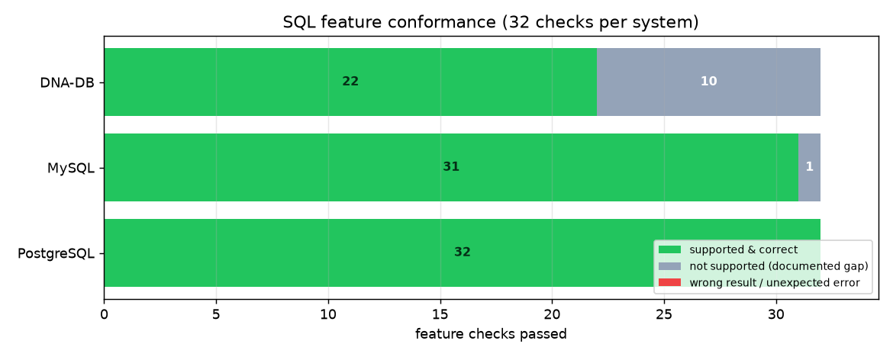

# SQL feature conformance: DNA-DB vs MySQL vs PostgreSQL

> **Russian:** [SQL_FEATURES_RU.md](SQL_FEATURES_RU.md) · Part of the bilingual docs set: [README](../README.md) · [DB_COMPARISON](DB_COMPARISON.md) · [SQL_MANUAL](SQL_MANUAL.md)

**Run date:** 2026-10-26 · **Test:** [scripts/sql_feature_test.py](../scripts/sql_feature_test.py) ·
**Raw data:** [sql_feature_results.json](sql_feature_results.json) · **Chart:** [charts/sql_features.png](charts/sql_features.png)

---

## 1. Result at a glance

32 feature checks were executed **with the same SQL text** against all three systems and every
result was compared with an independent Python reference model:

| System | Supported & correct | Not supported (rejected) | **Wrong result** | Unexpected error |
|---|---:|---:|---:|---:|
| **DNA-DB 3.0.0** | **22 / 32** | 10 | **0** | 0 |
| **MySQL 8.4.11** | **31 / 32** | 1 (FULL OUTER JOIN) | **0** | 0 |
| **PostgreSQL 17.11** | **32 / 32** | 0 | **0** | 0 |



**The headline:** in every case where DNA-DB *accepts* a statement it returns the **correct rows** —
0 mismatches across all three systems on 32 checks (JOINs, aggregates, NULL handling, index
results, DML). The gap is **feature coverage**, not correctness: the 10 "—" cells are statements
the parser rejects outright, never wrong answers.

---

## 2. Conformance table

| # | Feature | DNA-DB | MySQL | PostgreSQL |
|---|---|---|---|---|
| 1 | CREATE TABLE + PK + FK | ✅ | ✅ | ✅ |
| 2 | Duplicate primary key is rejected | ✅ | ✅ | ✅ |
| 3 | Foreign key violation is rejected | ✅ | ✅ | ✅ |
| 4 | SELECT with ORDER BY | ✅ | ✅ | ✅ |
| 5 | Projection aliases (AS) | ✅ | ✅ | ✅ |
| 6 | WHERE ... IN (list) | ✅ | ✅ | ✅ |
| 7 | WHERE with AND / != / comparison | ✅ | ✅ | ✅ |
| 8 | ORDER BY DESC + LIMIT/OFFSET | ✅ | ✅ | ✅ |
| 9 | IS NULL | ✅ | ✅ | ✅ |
| 10 | IS NOT NULL | — | ✅ | ✅ |
| 11 | Computed expression in SELECT (col \* 2) | — | ✅ | ✅ |
| 12 | ORDER BY with qualified column (t.col) | — | ✅ | ✅ |
| 13 | INNER JOIN | ✅ | ✅ | ✅ |
| 14 | LEFT JOIN with NULL extension | ✅ | ✅ | ✅ |
| 15 | RIGHT JOIN | — | ✅ | ✅ |
| 16 | FULL OUTER JOIN | — | — | ✅ |
| 17 | COUNT / SUM / AVG / MIN / MAX | ✅ | ✅ | ✅ |
| 18 | GROUP BY | ✅ | ✅ | ✅ |
| 19 | HAVING on aggregate | ✅ | ✅ | ✅ |
| 20 | ORDER BY aggregate alias | ✅ | ✅ | ✅ |
| 21 | Aggregates ignore NULL values | ✅ | ✅ | ✅ |
| 22 | WHERE x IN (SELECT ...) | ✅ | ✅ | ✅ |
| 23 | Scalar subquery in SELECT | — | ✅ | ✅ |
| 24 | CREATE INDEX on existing table | ✅ | ✅ | ✅ |
| 25 | Planner uses index for equality | ✅ | ✅ | ✅ |
| 26 | Planner uses index for range (>=) | ✅ | ✅ | ✅ |
| 27 | Index kept correct by UPDATE / DELETE | ✅ | ✅ | ✅ |
| 28 | DROP INDEX | ✅ | ✅ | ✅ |
| 29 | BEGIN / INSERT / ROLLBACK | — | ✅ | ✅ |
| 30 | UNION | — | ✅ | ✅ |
| 31 | Table introspection (dialect-specific) | — | ✅ | ✅ |
| 32 | EXPLAIN \<query\> | — | ✅ | ✅ |

Legend: ✅ statement executed and every returned value matched the reference model ·
— statement rejected by that system (documented gap) · ⚠ wrong rows · ❌ unexpected error.
**There are no ⚠ / ❌ cells in this run.**

---

## 3. How the test works

1. **Identical SQL text.** Each check sends the same statement to all three systems; the only
   dialect exceptions are documented per check (`DROP INDEX name` vs `DROP INDEX name ON tbl`,
   `SHOW TABLES` vs `information_schema`, `ANALYZE` before plan checks).
2. **Identical data.** 7 users (one with `balance = NULL`), 8 orders, and a 1 000-row
   `big_orders` table for index checks — loaded with the same INSERTs everywhere.
3. **Independent oracle.** Expected rows are computed in Python from a reference model, not from
   any of the databases; values compare with a 1e-6 float tolerance, and result order is only
   asserted when the statement has `ORDER BY` (otherwise set comparison).
4. **Honest plan introspection.** Index usage is checked through each system's own mechanism:
   DNA-DB returns a `plan` field in every SQL response (`IndexScan(big_orders.user_id IN (123))`),
   MySQL through `EXPLAIN` (`key=idx_big_user type=ref`), PostgreSQL through `EXPLAIN` after
   `ANALYZE` (`Bitmap Index Scan on idx_big_user` / `Index Scan using idx_big_total`).
5. **Rejection vs. failure.** A statement a system is *expected* to reject is recorded as
   "not supported"; a rejection where it must work would be ❌; wrong rows would be ⚠.

### What the index checks actually proved

| Check | DNA-DB | MySQL | PostgreSQL |
|---|---|---|---|
| equality (`user_id = 123`) | `IndexScan(big_orders.user_id IN (123))` | `key=idx_big_user type=ref` | `Bitmap Index Scan on idx_big_user` |
| range (`total_usd >= 1490`) | `IndexScan(big_orders.total_usd >=1490)` | `key=idx_big_total type=range` | `Index Scan using idx_big_total` |
| after `UPDATE` by indexed column | 1 row, correct | 1 row, correct | 1 row, correct |
| after `DELETE` of an indexed row | index entry removed | index entry removed | index entry removed |
| after `DROP INDEX` | full scan, still correct | correct | correct |

---

## 4. DNA-DB — the 10 rejected statements (with real error text)

| Feature | Actual response of `dna-db-core 3.0.0` |
|---|---|
| IS NOT NULL | `ERR: SQL: expected NULL` |
| `total_usd * 2` in SELECT | `ERR: SQL: expected FROM` |
| ORDER BY `t.col` (qualified) | `ERR: SQL: unexpected trailing tokens starting at Dot` |
| RIGHT JOIN | `ERR: SQL: unexpected trailing tokens starting at Ident("RIGHT")` |
| FULL OUTER JOIN | `ERR: SQL: unexpected trailing tokens starting at Ident("OUTER")` |
| Scalar subquery in SELECT | `ERR: SQL: expected identifier, got LParen` |
| BEGIN (SQL transaction) | `ERR: SQL: unsupported statement starting at Ident("BEGIN")` |
| UNION | `ERR: SQL: unexpected trailing tokens starting at Ident("UNION")` |
| SHOW TABLES | `ERR: SQL: unsupported statement starting at Ident("SHOW")` |
| EXPLAIN \<query\> | `ERR: SQL: unsupported statement starting at Ident("EXPLAIN")` |

These are **parser-level gaps**, not silent wrong behaviour: DNA-DB never fabricates a result.
Most of them are already declared in [SQL_MANUAL.md §3.5](SQL_MANUAL.md) (no RIGHT/FULL JOIN,
no UNION, no SQL transactions, materialized-only subqueries).

### Documentation vs. binary — a known discrepancy worth flagging

The binary under test is `dna-db-core 3.0.0` (`Cargo.toml`), while [SQL_MANUAL.md](SQL_MANUAL.md)
documents the **v3.1** SQL surface. Four documented statements are not in the binary yet:
`EXPLAIN`, `total_usd * 2` projections, `IS NOT NULL`, and `DROP INDEX name ON tbl`
(the binary takes `DROP INDEX name` — that form is what the test uses, so row 28 passes).
Until v3.1 ships, treat those manual examples as roadmap, not behaviour.

Note also what **does** work and is unusual for a v3 engine: `ORDER BY` on an aggregate alias,
`HAVING COUNT(*) > 2`, LEFT JOIN NULL extension, aggregates skipping NULLs, PK/FK enforcement, and
a planner that switches from `SeqScan` to `IndexScan` after `CREATE INDEX` (visible in the
response plan of every query).

---

## 5. MySQL and PostgreSQL gaps

* **MySQL 8.4** rejects `FULL OUTER JOIN` — `1064 ... right syntax to use near 'OUTER JOIN ...'`.
  PostgreSQL supports it. (This is the classic MySQL limitation; the workaround is
  `LEFT JOIN UNION ALL RIGHT JOIN`.) Everything else in the 32 checks passed, including
  transactions, RIGHT JOIN, UNION, EXPLAIN and `SHOW TABLES`.
* **PostgreSQL 17** passed all 32 checks.

---

## 6. What this test does *not* cover

* SQL surface of DNA-DB beyond the subset (no window functions, CTEs, `UNION ALL`, `ROLLUP`,
  correlated subqueries — none are claimed by the project).
* Performance — see [DB_COMPARISON.md](DB_COMPARISON.md) for the throughput/latency benchmark.
* Schema/permission/transaction isolation semantics (DNA-DB has no SQL transactions at all;
  atomicity is provided by batched WAL and DnaQL `TX {}`).
* DnaQL (DNA-DB's own language) — covered by `cargo test --lib dna_ql` and the smoke tests.

---

## 7. Reproduce

```bash
# three databases (Docker) — bench/bench/bench, root/bench for MySQL
docker run -d --name bench-pg    -e POSTGRES_USER=bench -e POSTGRES_PASSWORD=bench \
           -e POSTGRES_DB=bench -p 5432:5432 postgres:17
docker run -d --name bench-mysql -e MYSQL_ROOT_PASSWORD=bench \
           -e MYSQL_DATABASE=bench -p 3306:3306 mysql:8.4

cargo build --release
python scripts/sql_feature_test.py      # -> docs/sql_feature_results.json
python scripts/gen_charts.py            # -> docs/charts/sql_features.png
```

Each run starts DNA-DB in a fresh temporary data directory and rebuilds the MySQL/PostgreSQL
schema from scratch, so the result is reproducible and self-contained.
