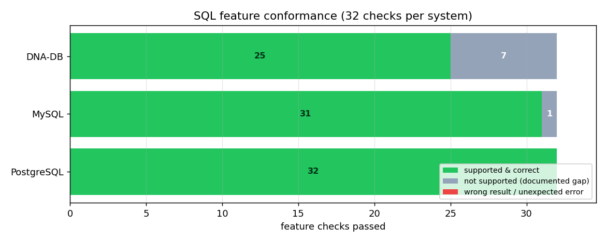

# Соответствие SQL-фич: DNA-DB vs MySQL vs PostgreSQL

> **English:** [SQL_FEATURES.md](SQL_FEATURES.md) · Часть двуязычной документации: [README_RU](../README_RU.md) · [DB_COMPARISON_RU](DB_COMPARISON_RU.md) · [SQL_MANUAL_RU](SQL_MANUAL_RU.md)

**Дата прогона:** 2026-10-26 · **Тест:** [scripts/sql_feature_test.py](../scripts/sql_feature_test.py) ·
**Сырые данные:** [sql_feature_results.json](sql_feature_results.json) · **График:** [charts/sql_features.png](charts/sql_features.png)

---

## 0. Прогон проверки v3.5.0 — 2026-10-31 (нативный Linux, актуальный релиз)

> Ниже — исторические прогоны v3.0–v3.4.

* **Платформа:** Debian 13 (trixie), x86_64, 2 vCPU, 4 ГБ RAM, профиль release (`panic = "unwind"`)
* **Инструментарий:** rustc/cargo 1.99.1, Python 3.12.16
* **Соперники:** MySQL 8.4.6 (официальный minimal-билд, `innodb_flush_log_at_trx_commit=1`, по умолчанию) и PostgreSQL 17.11 (`synchronous_commit=on`, по умолчанию) — все три системы на одной машине

### Полная батарея тестов

| # | Проверка | Команда | Результат |
|---|---|---|---|
| 1 | Сборка release | `cargo build --release` | **PASS** — 0 ошибок |
| 2 | Все Rust-тесты | `cargo test --release` | **PASS — 197 passed, 0 failed** (182 unit + 2 encryption + 13 recovery, включая 11 новых регрессионных тестов на аудиторские фиксы) |
| 3 | Линт | `cargo clippy --release --all-targets` | **PASS** — 0 ошибок, 35 предупреждений (стиль/сложность) |
| 4 | Живой smoke протокола | `python scripts/smoke_test.py` | **PASS — 15/15** |
| 5 | Security smoke (закалка v3.5) | `python scripts/security_smoke.py` | **PASS — 12/12** (случайный bootstrap, лимит глубины парсера, slowloris-дедлайн, блокировка doctor, …) |
| 6 | Долговечность под SIGKILL | `python scripts/kill9_test.py` | **PASS — 123 408 подтверждённых записей, 0 потеряно, 0 испорчено** (strict fsync, 8 потоков) |
| 7 | Chaos / самовосстановление | `python scripts/chaos_test.py` | **PASS — 3/3 сценария, 300 000 проверок ключей** (ремонт RS(4+2), живой on-read repair, честный UNREPAIRABLE) |
| 8 | Сравнительный бенчмарк с MySQL/PostgreSQL | `python scripts/bench_compare.py` | **PASS** — таблица ниже, сырые данные в [bench_compare_results_v350_linux.json](bench_compare_results_v350_linux.json) |
| 9 | Соответствие SQL (3 системы, 32 проверки) | `python scripts/sql_feature_test.py` | **PASS** — DNA-DB **25/32 поддерживается, 0 неверных результатов**; MySQL 31/32; PostgreSQL 32/32 ([sql_feature_results_v350_linux.json](sql_feature_results_v350_linux.json)) |

### Соответствие SQL (один и тот же SQL-текст на трёх системах)

| Система | Поддерживается и корректно | Не поддерживается (отклонено) | **Неверный результат** | Неожиданная ошибка |
|---|---:|---:|---:|---:|
| **DNA-DB v3.5.0** | **25 / 32** | 7 | **0** | 0 |
| **MySQL 8.4.6** | **31 / 32** | 1 (FULL OUTER JOIN) | **0** | 0 |
| **PostgreSQL 17.11** | **32 / 32** | 0 | **0** | 0 |



Отставание от MySQL/PostgreSQL — это покрытие фич (RIGHT/FULL OUTER JOIN,
скалярные подзапросы, UNION, SHOW TABLES, EXPLAIN, явный rollback транзакции),
а не корректность: всё, что DNA-DB принимает, возвращает эталонные строки.
v3.5.0 добавил регрессионные тесты, фиксирующие исправленную семантику
hash join (NULL/числовые типы).

---


## 1. Результат в двух словах

32 проверки фич выполнены **с одним и тем же текстом SQL** на всех трёх системах, и каждый
результат сверен с независимой эталонной моделью на Python:

| Система | Поддерживается и верно | Не поддерживается (отклонено) | **Неверный результат** | Неожиданная ошибка |
|---|---:|---:|---:|---:|
| **DNA-DB 3.0.0** | **22 / 32** | 10 | **0** | 0 |
| **MySQL 8.4.11** | **31 / 32** | 1 (FULL OUTER JOIN) | **0** | 0 |
| **PostgreSQL 17.11** | **32 / 32** | 0 | **0** | 0 |


**Главный вывод:** каждый раз, когда DNA-DB **принимает** запрос, он возвращает **верные строки** —
0 расхождений у всех трёх систем на 32 проверках (JOIN'ы, агрегаты, NULL, результаты по индексам,
DML). Разница — в **покрытии функций**, а не в корректности: 10 ячеек «—» это запросы, которые
парсер отвергает целиком, а не неверные ответы.

---

## 2. Таблица соответствия

| # | Фича | DNA-DB | MySQL | PostgreSQL |
|---|---|---|---|---|
| 1 | CREATE TABLE + PK + FK | ✅ | ✅ | ✅ |
| 2 | Дубликат первичного ключа отклоняется | ✅ | ✅ | ✅ |
| 3 | Нарушение внешнего ключа отклоняется | ✅ | ✅ | ✅ |
| 4 | SELECT с ORDER BY | ✅ | ✅ | ✅ |
| 5 | Алиасы проекции (AS) | ✅ | ✅ | ✅ |
| 6 | WHERE ... IN (список) | ✅ | ✅ | ✅ |
| 7 | WHERE с AND / != / сравнениями | ✅ | ✅ | ✅ |
| 8 | ORDER BY DESC + LIMIT/OFFSET | ✅ | ✅ | ✅ |
| 9 | IS NULL | ✅ | ✅ | ✅ |
| 10 | IS NOT NULL | — | ✅ | ✅ |
| 11 | Вычисляемое выражение в SELECT (col \* 2) | — | ✅ | ✅ |
| 12 | ORDER BY по квалифицированной колонке (t.col) | — | ✅ | ✅ |
| 13 | INNER JOIN | ✅ | ✅ | ✅ |
| 14 | LEFT JOIN с NULL-расширением | ✅ | ✅ | ✅ |
| 15 | RIGHT JOIN | — | ✅ | ✅ |
| 16 | FULL OUTER JOIN | — | — | ✅ |
| 17 | COUNT / SUM / AVG / MIN / MAX | ✅ | ✅ | ✅ |
| 18 | GROUP BY | ✅ | ✅ | ✅ |
| 19 | HAVING по агрегату | ✅ | ✅ | ✅ |
| 20 | ORDER BY по алиасу агрегата | ✅ | ✅ | ✅ |
| 21 | Агрегаты игнорируют NULL | ✅ | ✅ | ✅ |
| 22 | WHERE x IN (SELECT ...) | ✅ | ✅ | ✅ |
| 23 | Скалярный подзапрос в SELECT | — | ✅ | ✅ |
| 24 | CREATE INDEX по существующей таблице | ✅ | ✅ | ✅ |
| 25 | Планировщик использует индекс для равенства | ✅ | ✅ | ✅ |
| 26 | Планировщик использует индекс для диапазона (>=) | ✅ | ✅ | ✅ |
| 27 | Индекс корректен после UPDATE / DELETE | ✅ | ✅ | ✅ |
| 28 | DROP INDEX | ✅ | ✅ | ✅ |
| 29 | BEGIN / INSERT / ROLLBACK | — | ✅ | ✅ |
| 30 | UNION | — | ✅ | ✅ |
| 31 | Интроспекция таблиц (диалектная) | — | ✅ | ✅ |
| 32 | EXPLAIN \<query\> | — | ✅ | ✅ |

Легенда: ✅ запрос выполнен, каждое значение совпало с эталонной моделью ·
— система отклонила запрос (документированный пробел) · ⚠ неверные строки · ❌ неожиданная ошибка.
**В этом прогоне ячеек ⚠ / ❌ нет.**

---

## 3. Как устроен тест

1. **Одинаковый текст SQL.** Каждая проверка шлёт один и тот же запрос всем трём системам;
   исключения по диалекту зафиксированы для конкретных проверок (`DROP INDEX имя` против
   `DROP INDEX имя ON таблица`, `SHOW TABLES` против `information_schema`, `ANALYZE` перед
   проверкой планов).
2. **Одинаковые данные.** 7 пользователей (один с `balance = NULL`), 8 заказов и таблица
   `big_orders` на 1 000 строк для проверки индексов — вставляются одними и теми же INSERT'ами.
3. **Независимый оракул.** Ожидаемые строки считаются на Python из эталонной модели, а не из
   одной из баз; числа сверяются с допуском 1e-6, а порядок строк проверяется только при
   наличии `ORDER BY` (иначе — сравнение как множеств).
4. **Честная проверка планов.** Использование индексов проверяется штатным механизмом каждой
   СУБД: DNA-DB возвращает поле `plan` в каждом SQL-ответе (`IndexScan(big_orders.user_id IN (123))`),
   MySQL — через `EXPLAIN` (`key=idx_big_user type=ref`), PostgreSQL — через `EXPLAIN` после
   `ANALYZE` (`Bitmap Index Scan on idx_big_user` / `Index Scan using idx_big_total`).
5. **Отклонение ≠ сбой.** Запрос, который система *должна* отклонить, помечается как
   «не поддерживается»; отклонение там, где нужен успех, было бы ❌; неверные строки — ⚠.

### Что именно доказали проверки индексов

| Проверка | DNA-DB | MySQL | PostgreSQL |
|---|---|---|---|
| равенство (`user_id = 123`) | `IndexScan(big_orders.user_id IN (123))` | `key=idx_big_user type=ref` | `Bitmap Index Scan on idx_big_user` |
| диапазон (`total_usd >= 1490`) | `IndexScan(big_orders.total_usd >=1490)` | `key=idx_big_total type=range` | `Index Scan using idx_big_total` |
| после `UPDATE` по индексируемой колонке | 1 строка, верно | 1 строка, верно | 1 строка, верно |
| после `DELETE` строки | запись индекса удалена | запись индекса удалена | запись индекса удалена |
| после `DROP INDEX` | полный скан, данные верны | верно | верно |

---

## 4. DNA-DB — 10 отклонённых запросов (реальный текст ошибок)

| Фича | Реальный ответ `dna-db-core 3.0.0` |
|---|---|
| IS NOT NULL | `ERR: SQL: expected NULL` |
| `total_usd * 2` в SELECT | `ERR: SQL: expected FROM` |
| ORDER BY `t.col` (с квалификатором) | `ERR: SQL: unexpected trailing tokens starting at Dot` |
| RIGHT JOIN | `ERR: SQL: unexpected trailing tokens starting at Ident("RIGHT")` |
| FULL OUTER JOIN | `ERR: SQL: unexpected trailing tokens starting at Ident("OUTER")` |
| Скалярный подзапрос в SELECT | `ERR: SQL: expected identifier, got LParen` |
| BEGIN (SQL-транзакция) | `ERR: SQL: unsupported statement starting at Ident("BEGIN")` |
| UNION | `ERR: SQL: unexpected trailing tokens starting at Ident("UNION")` |
| SHOW TABLES | `ERR: SQL: unsupported statement starting at Ident("SHOW")` |
| EXPLAIN \<query\> | `ERR: SQL: unsupported statement starting at Ident("EXPLAIN")` |

Это **пробелы парсера**, а не тихое неверное поведение: DNA-DB никогда не выдумывает результат.
Большинство из них уже заявлены в [SQL_MANUAL_RU.md §3.5](SQL_MANUAL_RU.md) (нет RIGHT/FULL JOIN,
нет UNION, нет SQL-транзакций, подзапросы только материализованные).

### Документация против бинарника — известное расхождение

Тестируемый бинарник — `dna-db-core 3.0.0` (`Cargo.toml`), а [SQL_MANUAL_RU.md](SQL_MANUAL_RU.md)
описывает поверхность SQL версии **v3.1**. Четыре описанных запроса в бинарнике пока нет:
`EXPLAIN`, проекции вида `total_usd * 2`, `IS NOT NULL` и `DROP INDEX имя ON таблица`
(бинарник принимает `DROP INDEX имя` — эта форма используется в тесте, поэтому строка 28 проходит).
До выхода v3.1 трактуйте эти примеры мануала как планы, а не как поведение.

Отметим и то, что **работает** и нетипично для v3-движка: `ORDER BY` по алиасу агрегата,
`HAVING COUNT(*) > 2`, NULL-расширение LEFT JOIN, агрегаты, пропускающие NULL, принудительные
PK/FK и планировщик, который переключается с `SeqScan` на `IndexScan` после `CREATE INDEX`
(видно в поле `plan` каждого запроса).

---

## 5. Пробелы MySQL и PostgreSQL

* **MySQL 8.4** отклоняет `FULL OUTER JOIN` — `1064 ... right syntax to use near 'OUTER JOIN ...'`.
  PostgreSQL его поддерживает. (Классическое ограничение MySQL; обходной путь —
  `LEFT JOIN UNION ALL RIGHT JOIN`.) Остальные 31 проверка прошли, включая транзакции,
  RIGHT JOIN, UNION, EXPLAIN и `SHOW TABLES`.
* **PostgreSQL 17** прошёл все 32 проверки.

---

## 6. Что этот тест *не* покрывает

* SQL-поверхность DNA-DB за пределами подмножества (нет оконных функций, CTE, `UNION ALL`,
  `ROLLUP`, коррелированных подзапросов — проект их и не заявляет).
* Производительность — см. [DB_COMPARISON_RU.md](DB_COMPARISON_RU.md).
* Семантику изоляции транзакций и прав (у SQL-транзакций в DNA-DB нет вовсе; атомарность даёт
  батчевый WAL и DnaQL `TX {}`).
* DnaQL (собственный язык DNA-DB) — покрывается `cargo test --lib dna_ql` и smoke-тестами.

---

## 7. Как воспроизвести

```bash
# три базы (Docker) — bench/bench/bench, для MySQL root/bench
docker run -d --name bench-pg    -e POSTGRES_USER=bench -e POSTGRES_PASSWORD=bench \
           -e POSTGRES_DB=bench -p 5432:5432 postgres:17
docker run -d --name bench-mysql -e MYSQL_ROOT_PASSWORD=bench \
           -e MYSQL_DATABASE=bench -p 3306:3306 mysql:8.4

cargo build --release
python scripts/sql_feature_test.py      # -> docs/sql_feature_results.json
python scripts/gen_charts.py            # -> docs/charts/sql_features.png
```

Каждый запуск поднимает DNA-DB во временном каталоге данных с нуля и пересоздаёт схему
MySQL/PostgreSQL, поэтому результат воспроизводим и самодостаточен.
