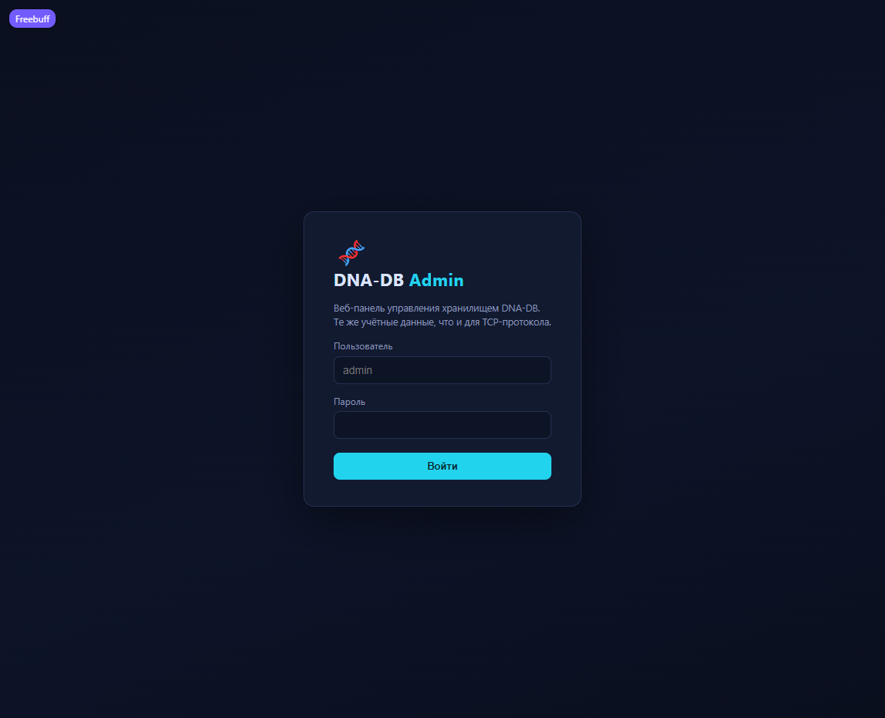
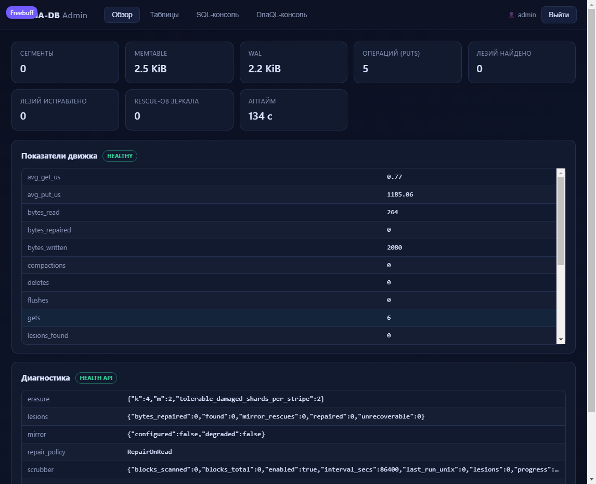
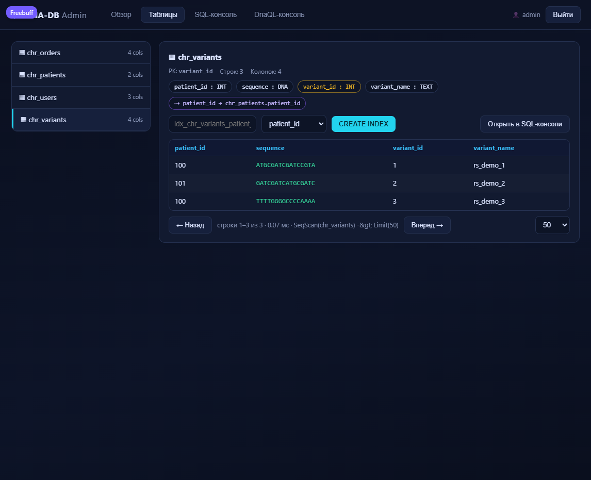
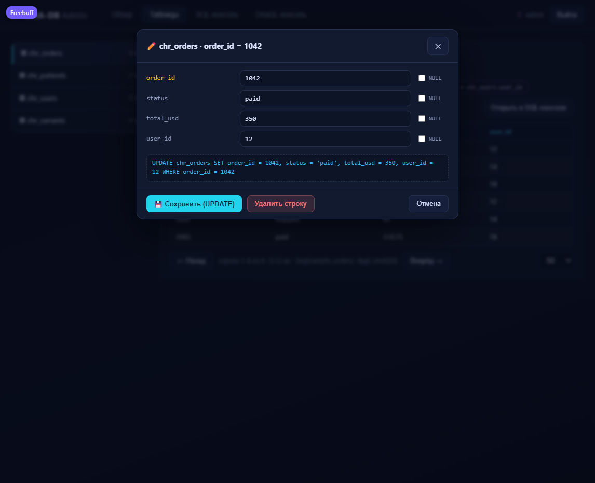
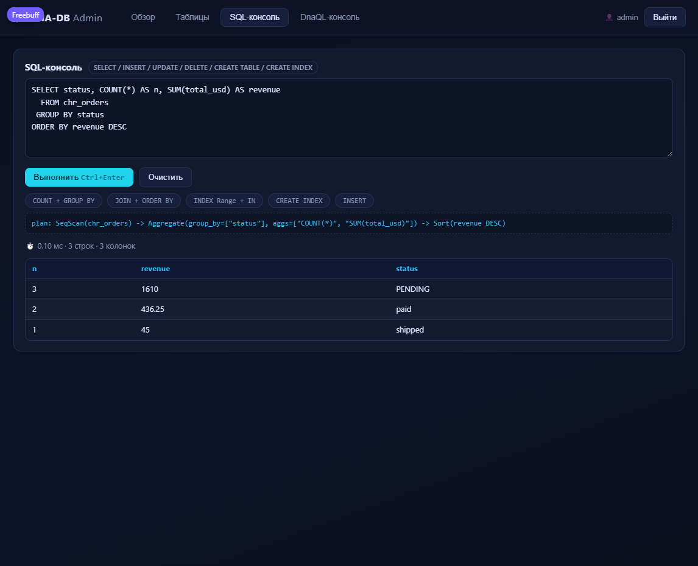
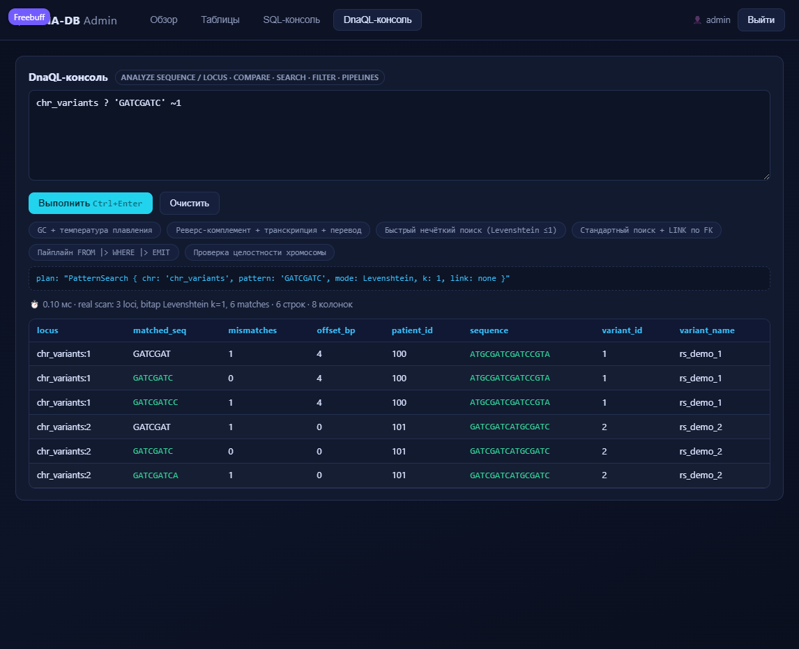

# Complete guide: SQL and the DNA-DB web panel v3.1

**Official DNA-DB Core documentation.** All examples were verified on a
built engine (see `cargo test --release`: 152 tests, 0 warnings).

> **Russian:** [SQL_MANUAL_RU.md](SQL_MANUAL_RU.md)

---

## Chapter 1. Quick start

```bash
cargo build --release

# server + web panel on 8080 (password is mandatory)
export DNA_DB_ADMIN_PASS='your_password'
./target/release/dna-db-core serve \
    --data-dir ./dna_data \
    --port 9999 \
    --admin-port 8080 \
    --demo-data

# then open in a browser:
#   web panel:  http://127.0.0.1:8080/
#   TCP protocol: 127.0.0.1:9999 (shell client)
```

`serve` flags:

| Flag | Default | Purpose |
|---|---|---|
| `--data-dir` | `./dna_data` | data directory (WAL, segments, repair journal) |
| `--port` | `9999` | DNA-DB TCP protocol port |
| `--bind` | `127.0.0.1` | interface; `0.0.0.0` explicitly for remote access |
| `--admin-port` | `8080` | web panel port; `0` disables the panel |
| `--admin-user` | `admin` | login (same for TCP and the web panel) |
| `--admin-pass` | — | password; alternative: the `DNA_DB_ADMIN_PASS` variable |
| `--sync` | `strict` | `strict` / `batched` / `async` — fsync policy |
| `--memtable-mb` | `8` | memtable capacity in MiB |
| `--mirror-dir` | — | path of the second disk (Dual-Strand hot-swap) |
| `--demo-data` | off | seed demo tables (see Chapter 3) |
| `--no-scrub` | off | disable the background scrubber |
| `--erasure-k` / `--erasure-m` | `4` / `2` | Reed–Solomon geometry |

---

## Chapter 2. The web panel (phpMyAdmin for DNA-DB)

The panel is a single HTTP server inside the binary (zero external
dependencies, an SPA in embedded HTML). The credentials are **the same**
as for the TCP protocol, and so are the protections: salt + SHA-256,
constant-time comparison, IP lockout after failed attempts; sessions are
bearer tokens with a 12-hour TTL.

### 2.1. Login screen



Login/password come from `--admin-user` / `--admin-pass`. The panel
listens on **loopback only** by default; for remote access use an SSH
tunnel:

```bash
ssh -L 8080:127.0.0.1:8080 user@db-host
```

### 2.2. Overview (dashboard)



Four blocks:

- **Cards**: segments, memtable/WAL size, operation counters, "lesions"
  found and repaired, mirror rescues, uptime.
- **Engine metrics** — all real counters from `stats.summary()`
  (puts/gets/deletes, bytes, flush/compaction, average latencies).
- **Diagnostics** — a snapshot of `Engine::health()`: Reed–Solomon
  geometry, lesion counters, mirror status, repair policy, scrubber
  progress.

### 2.3. Tables (browser)



- on the left — the list of tables with column counts;
- on top — the schema: **PK** (yellow chip), columns with types, **FK**
  (purple), **indexes** (teal);
- a row browser with pagination (`LIMIT`/`OFFSET`), the plan and query
  time;
- DNA sequences are highlighted automatically;
- **CREATE INDEX** — name + column → `CREATE INDEX … ON t (col)`;
- the ✕ on an index chip → `DROP INDEX`;
- "Open in SQL console" inserts `SELECT * FROM … LIMIT 50`;
- **clicking a row** → the edit modal (see 2.4).

### 2.4. Row editing (modal dialog)



Clicking any row in the grid opens a phpMyAdmin-style modal:

- **fields follow the schema columns** — the PK is highlighted yellow and
  marked `(PRIMARY KEY)`, the column type is applied automatically
  (`INT`/`FLOAT` → numeric literal, `TEXT`/`DNA` → string);
- a **NULL checkbox** per column — sets the field to NULL and disables
  input (the engine receives `col = NULL`, not an empty string);
- **live SQL preview** — the generated `UPDATE … WHERE pk = …` is
  recomputed on every field change: you see exactly what will be sent to
  the engine (a `PointGet` on the PK);
- **💾 Save (UPDATE)** — runs the query, closes the dialog and refreshes
  the grid from the server; errors (FK violations, duplicate PK, wrong
  type) are shown inside the dialog without losing your input;
- **Delete row** — `DELETE FROM t WHERE pk = …` with confirmation;
- **Cancel / ✕ / Esc** — close without changes (clicking the backdrop
  works too).

Special characters in strings are escaped per the SQL standard
(`'` → `''`); negative and floating-point numbers serialize correctly —
both paths are covered by tokenizer tests.

### 2.5. SQL console



Any SQL from Chapter 3. The panel shows the **execution plan**
(`SeqScan` / `IndexScan` / `InnerHashJoin` / `Aggregate` / `Sort`), time
in ms, row/column counts and the message. Errors appear in a separate
red block (for example an FK violation). The example buttons at the
bottom are ready-made queries.

### 2.6. DnaQL console



`ANALYZE … |> GC_CONTENT()` pipelines, fuzzy search `chr ? 'PAT' ~1`,
`FIND PATTERN … LINK …`, `FROM t |> WHERE … |> EMIT …`,
`VERIFY CHROMOSOME …` — everything described in
[DNAQL_MANUAL.md](DNAQL_MANUAL.md).

### 2.7. Panel HTTP API

For scripts and integrations (every route except `/` and `/api/login`
requires `Authorization: Bearer <token>`):

| Method | Path | Body/params | Response |
|---|---|---|---|
| POST | `/api/login` | `{"user","pass"}` | `{"token","user"}` |
| GET | `/api/health` | — | `{health, stats, segments, memtable_bytes, wal_bytes, data_dir}` |
| GET | `/api/tables` | — | `{tables: [{name, columns, pk, fks, indexes}]}` |
| GET | `/api/browse` | `?table=&limit=&offset=` | `{columns, rows, total, plan, time_us}` |
| POST | `/api/query` | `{"kind":"sql"\|"dnaql","query":…}` | `{columns, rows, plan, time_us, …}` |

```bash
TOKEN=$(curl -s -X POST http://127.0.0.1:8080/api/login \
  -H 'Content-Type: application/json' \
  -d '{"user":"admin","pass":"…"}' | jq -r .token)

curl -s -X POST http://127.0.0.1:8080/api/query \
  -H "Authorization: Bearer $TOKEN" -H 'Content-Type: application/json' \
  -d '{"kind":"sql","query":"SELECT status, COUNT(*) FROM chr_orders GROUP BY status"}'
```

Errors return 400/401/404/423 with `{"error": "…"}`.
Table names in `/api/browse` are validated (`[A-Za-z0-9_]`) before the
query is built — SQL injection through parameters is impossible.

---

## Chapter 3. The SQL subset v3.1

### 3.1. DDL

```sql
CREATE TABLE chr_users (
  user_id  INT,          -- INT | FLOAT | TEXT | DNA | TIMESTAMP
  username TEXT,
  balance  FLOAT,
  PRIMARY KEY (user_id)
);

CREATE TABLE chr_orders (
  order_id   INT,
  user_id    INT,
  total_usd  FLOAT,
  status     TEXT,
  PRIMARY KEY (order_id),
  FOREIGN KEY (user_id) REFERENCES chr_users(user_id) ON DELETE CASCADE
);

CREATE TABLE chr_seqs (            -- DNA column (2-bit packing)
  seq_id INT, sequence DNA, PRIMARY KEY (seq_id)
);

DROP TABLE chr_orders;             -- cascade cleans up indexes and rows
```

Types:
`INT` (i64) · `FLOAT` (f64) · `TEXT` · `DNA` (A/C/G/T-only string, stored
as `Value::Dna`, compared to text in a type-aware way) · `TIMESTAMP`.
`PRIMARY KEY` is mandatory — it is the row's locus key in the LSM.

### 3.2. DML

```sql
-- positional form
INSERT INTO chr_users (user_id, username, balance) VALUES (14, 'prof_crick', 890.0);
-- typed form (convenient for scripts)
INSERT INTO chr_users (user_id = 18, username = 'rosalind_f', balance = 12.5);

UPDATE chr_users SET balance = 950.0 WHERE user_id = 14;
UPDATE chr_orders SET status = 'shipped' WHERE order_id IN (2001, 2002);

DELETE FROM chr_users WHERE user_id = 14;      -- ON DELETE CASCADE cleans chr_orders
DELETE FROM chr_orders WHERE total_usd > 1000; -- bulk delete
```

- `WHERE` without the primary key → full scan with a filter;
  `WHERE` on the PK (equality list) → **point-lookup**.
- An INSERT violating an FK → error `FK violation: col=v not found in 't'`.
- `IN (SELECT …)` is materialized before execution (works in
  SELECT/UPDATE/DELETE).

### 3.3. SELECT — the full set

```sql
-- projection, aliases, *
SELECT * FROM chr_orders;
SELECT order_id AS id, total_usd * 2 AS double_total FROM chr_orders;

-- filters: = != <> < <= > >=, AND/OR/NOT, IS NULL, IN-lists, IN-subqueries
SELECT * FROM chr_orders WHERE status != 'paid' AND total_usd IS NOT NULL;
SELECT * FROM chr_orders WHERE status IN ('paid','shipped');
SELECT * FROM chr_orders
  WHERE user_id IN (SELECT user_id FROM chr_users WHERE balance > 100);

-- JOIN (INNER / LEFT), with aliases and an implicit ON
SELECT u.username, o.total_usd
  FROM chr_orders o INNER JOIN chr_users u ON o.user_id = u.user_id
 WHERE o.total_usd > 300;
SELECT u.username, o.order_id
  FROM chr_users u LEFT JOIN chr_orders o ON u.user_id = o.user_id;

-- aggregates + grouping + filter on aggregates
SELECT status, COUNT(*) AS n, SUM(total_usd) AS revenue, AVG(total_usd) AS avg_total
  FROM chr_orders GROUP BY status
 HAVING COUNT(*) > 1
 ORDER BY revenue DESC;

-- sorting (ASC/DESC), by aggregates and aliases
SELECT user_id, MAX(total_usd) AS top FROM chr_orders GROUP BY user_id ORDER BY top DESC;

-- pagination (OFFSET consumes the first rows and then discards them)
SELECT * FROM chr_orders ORDER BY order_id LIMIT 10 OFFSET 20;

-- introspection commands
SHOW TABLES;
SHOW HEALTH;
```

The keyword aliases
`FROM WHERE GROUP HAVING ORDER LIMIT OFFSET JOIN ON` cannot serve as
aliases — the parser stops on them correctly.

### 3.4. Secondary indexes and plans

```sql
CREATE INDEX idx_orders_status ON chr_orders (status);
CREATE INDEX idx_orders_total  ON chr_orders (total_usd);

EXPLAIN SELECT order_id FROM chr_orders WHERE status = 'paid';
-- -> IndexScan(chr_orders.status IN (paid)) -> Filter(status = paid) -> Project([...])

EXPLAIN SELECT order_id FROM chr_orders WHERE total_usd > 100 AND total_usd < 600;
-- -> IndexScan(chr_orders.total_usd >100 AND <600) -> Filter(...) -> Sort(total_usd ASC) -> ...

DROP INDEX idx_orders_total ON chr_orders;
```

How it works:

- index entries live in the same LSM under the prefix
  `__idx:<table>:<index>:` with an encoded value (`encode_index_value`) —
  types are distinguished (`1` != `'1'`), NULL sorts first;
- **equality** and an `IN`-list on an indexed column → `IndexScan` over
  encoded point keys;
- **range** (`>`, `>=`, `<`, `<=` with constants) → `IndexScan` over a
  range bounded by a common start/end prefix (segments stay prunable);
- the plan is always honest: if the index does not apply (composite
  expression etc.) you see `SeqScan -> Filter`;
- DML honours indexes: INSERT/UPDATE/DELETE insert/delete index entries
  in lockstep with the data; `DROP TABLE` cleans every index;
  `CREATE INDEX` on an existing table builds the index over current rows.

### 3.5. Limitations (honest list)

- subqueries are materialized (no correlated subqueries) — `IN (SELECT …)`;
- no `RIGHT JOIN`, `FULL JOIN`, `UNION`, `GROUP BY ROLLUP`;
- no index-based JOIN plans (JOIN is a hash join on the FK);
- no transactions in SQL (atomicity goes through batched WAL / DnaQL `TX {}`);
- no TLS on TCP/HTTP — for remote access use SSH/stunnel/VPN
  (see README, "Limitations").

---

## Chapter 4. Tests — how to reproduce

```bash
cargo test --release              # 152 tests: 139 lib + 13 integration
python3 scripts/kill9_test.py     # kill -9: 99 091 records, 0 lost
python3 scripts/chaos_test.py     # corrupt 80 sectors -> doctor --fix -> 100%
./target/release/dna-db-core bench # real CPU/disk measurements
```

Live verification of the panel (starts a real HTTP server, logs in,
browses tables and runs SQL and DnaQL over HTTP):

```bash
cargo test --release panel_requires_auth_and_serves_api -- --nocapture
```

Results of the latest run: [TEST_RESULTS.md](TEST_RESULTS.md).
