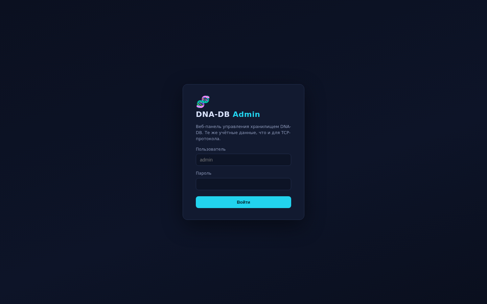
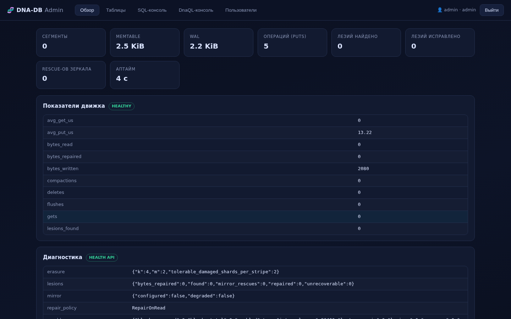
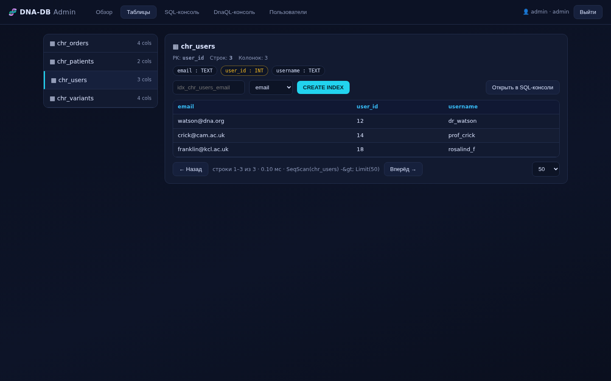
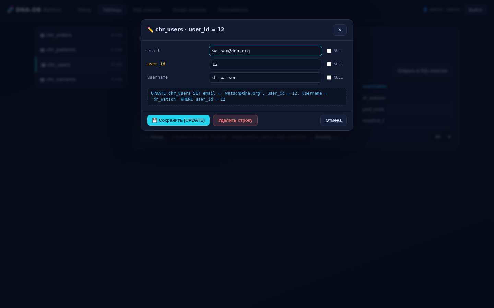
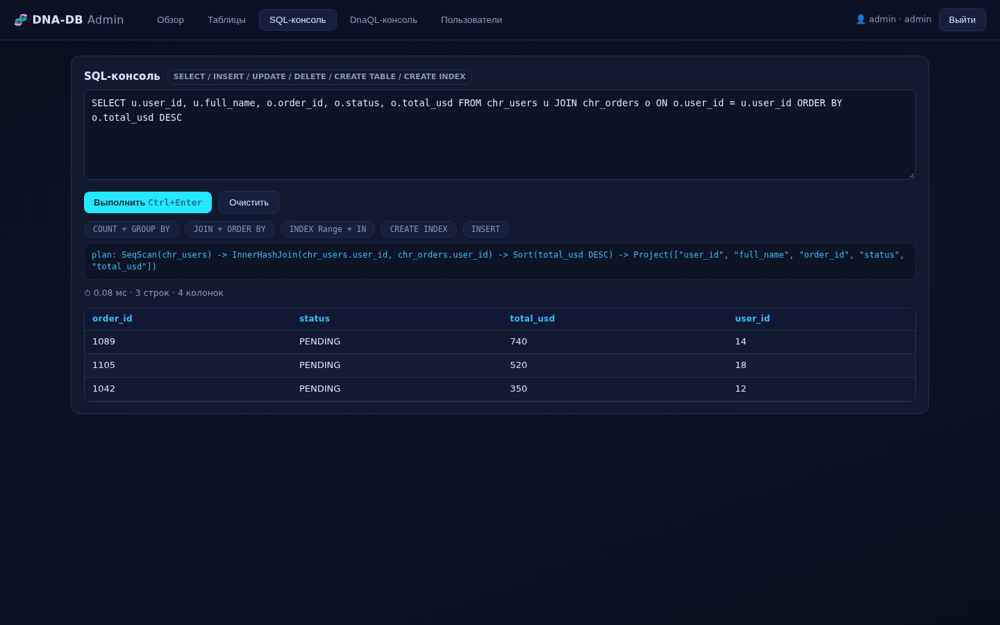
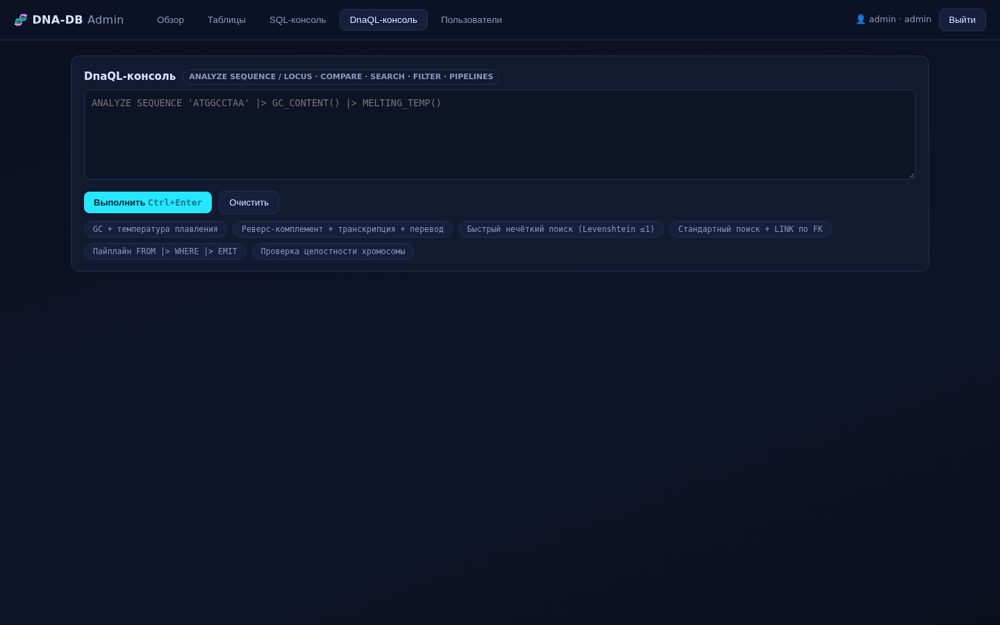

# Полное руководство: SQL и веб-панель DNA-DB v3.1

> **English:** [SQL_MANUAL.md](SQL_MANUAL.md)

**Официальная документация DNA-DB Core.** Все примеры проверены на собранном
движке (см. `cargo test --release`: 152 теста, 0 warnings).

---

## Глава 1. Быстрый старт

```bash
cargo build --release

# сервер + веб-панель на 8080 (пароль обязателен)
export DNA_DB_ADMIN_PASS='ваш_пароль'
./target/release/dna-db-core serve \
    --data-dir ./dna_data \
    --port 9999 \
    --admin-port 8080 \
    --demo-data

# затем откройте в браузере:
#   веб-панель:  http://127.0.0.1:8080/
#   TCP-протокол: 127.0.0.1:9999 (shell-клиент)
```

Флаги `serve`:

| Флаг | По умолчанию | Назначение |
|---|---|---|
| `--data-dir` | `./dna_data` | каталог данных (WAL, сегменты, журнал репараций) |
| `--port` | `9999` | TCP-порт протокола DNA-DB |
| `--bind` | `127.0.0.1` | интерфейс; `0.0.0.0` — явно для удалённого доступа |
| `--admin-port` | `8080` | порт веб-панели; `0` — отключить панель |
| `--admin-user` | `admin` | логин (одинаков для TCP и веб-панели) |
| `--admin-pass` | — | пароль; альтернатива — переменная `DNA_DB_ADMIN_PASS` |
| `--sync` | `strict` | `strict` / `batched` / `async` — политика fsync |
| `--memtable-mb` | `8` | ёмкость memtable в MiB |
| `--mirror-dir` | — | путь второго диска (Dual-Strand hot-swap) |
| `--demo-data` | выкл. | засеять демо-таблицы (см. Глава 3) |
| `--no-scrub` | выкл. | отключить фоновый scrubber |
| `--erasure-k` / `--erasure-m` | `4` / `2` | геометрия Reed–Solomon |

---

## Глава 2. Веб-панель (phpMyAdmin для DNA-DB)

Панель — один HTTP-сервер внутри бинаря (ноль внешних зависимостей, SPA
во встроенном HTML). Учётные данные **те же**, что у TCP-протокола, и
те же меры защиты: соль + SHA-256, constant-time сравнение, блокировка
IP после неудачных попыток; сессии — bearer-токен с TTL 12 часов.

### 2.1. Экран входа



Логин/пароль — от `--admin-user` / `--admin-pass`. Панель по умолчанию
слушает **только loopback**; для удалённого доступа используйте SSH-туннель:

```bash
ssh -L 8080:127.0.0.1:8080 user@db-host
```

### 2.2. Обзор (дашборд)



Пять блоков:

- **Карточки**: сегменты, размер memtable/WAL, «Данные на диске» (весь
  каталог данных), счётчик компакций, счётчик операций, найденные и
  исправленные «лезии», rescue-ы зеркала, аптайм.
- **Показатели движка** — все реальные счётчики `stats.summary()`
  (puts/gets/deletes, байты, flush/compaction, средние латентности).
- **Диагностика** — снимок `Engine::health()`: геометрия Reed–Solomon,
  счётчики lesions, статус зеркала, политика репарации, прогресс scrubber'а.
- **Обслуживание** — кнопка **🧬 Компакция** (только admin) запускает
  онлайн-компакцию и показывает размер каталога до → после; под ней —
  таблица **истории компакций** из дискового журнала (см. 3.3b).

### 2.3. Таблицы (браузер)



- слева — список таблиц с числом колонок;
- сверху — схема: **PK** (жёлтый чип), колонки с типами, **FK** (фиолетовый),
  **индексы** (бирюзовый);
- браузер строк с пагинацией (`LIMIT`/`OFFSET`), планом и временем запроса;
- DNA-последовательности подсвечиваются автоматически;
- **CREATE INDEX** — имя + колонка → `CREATE INDEX … ON t (col)`;
- крестик на чипе индекса → `DROP INDEX`;
- «Открыть в SQL-консоли» — подставляет `SELECT * FROM … LIMIT 50`;
- **🔬 у каждой строки** — открывает физическую карту хранения
  (`SHOW STORAGE FOR <таблица> WHERE <pk> = …`) в модальном окне; кнопка
  «🧬 STORAGE_MAP в DnaQL-консоли» передаёт эквивалентную команду
  `ANALYZE LOCUS <таблица>:<pk> |> STORAGE_MAP();` в DnaQL-консоль и
  выполняет её (см. 3.3a);
- **клик по строке** → модальное окно редактирования (см. 2.4).

### 2.4. Редактирование строки (модальное окно)



Клик по любой строке сетки открывает модальное окно в стиле phpMyAdmin:

- **поля по колонкам схемы** — PK подсвечен жёлтым и помечен
  `(PRIMARY KEY)`, тип колонки подставляется автоматически
  (`INT`/`FLOAT` → числовой литерал, `TEXT`/`DNA` → строковый);
- **галочка NULL** у каждой колонки — переводит поле в NULL и
  отключает ввод (движок получает `col = NULL`, а не пустую строку);
- **живое SQL-превью** — генерируемый `UPDATE … WHERE pk = …`
  пересчитывается при каждом изменении поля: видно ровно то,
  что уйдёт в движок (точечный `PointGet` по PK);
- **💾 Сохранить (UPDATE)** — выполняет запрос, закрывает окно и
  обновляет сетку из сервера; ошибки (нарушение FK, дубликат PK,
  неверный тип) выводятся прямо в окне без потери введённых данных;
- **Удалить строку** — `DELETE FROM t WHERE pk = …` с подтверждением;
- **Отмена / ✕ / Esc** — закрыть без изменений (клик по подложке тоже).

Спецсимволы в строках экранируются по стандарту SQL (`'` → `''`),
отрицательные числа и числа с плавающей точкой корректно
сериализуются — обе ветки покрыты тестами токенизатора.

### 2.5. SQL-консоль



Любой SQL из Главы 3. Панель показывает **план выполнения** (`SeqScan` /
`IndexScan` / `InnerHashJoin` / `Aggregate` / `Sort`), время в мс, число
строк/колонок и сообщение. Ошибки выводятся отдельным красным блоком
(например, нарушение FK). Кнопки-примеры внизу — готовые запросы.

**v4.1:** кнопка **SQL → DnaQL** транслирует текущее выражение в
DnaQL-форму (тот же транслятор, что у CLI `sql2dnaql`) и показывает
физическую карту хранения — хромосому, локус, ключ и RowCodec-
представление — **ничего не выполняя** (`POST /api/explain`); блок также
появляется автоматически после каждой изменяющей команды. `SHOW STORAGE`
— SQL-only: explain-блок называет DnaQL-эквивалент
(`ANALYZE LOCUS <таблица>:<pk> |> STORAGE_MAP()`), а не транслирует его.

### 2.6. DnaQL-консоль



Пайплайны `ANALYZE … |> GC_CONTENT()`, нечёткий поиск `chr ? 'PAT' ~1`,
`FIND PATTERN … LINK …`, `FROM t |> WHERE … |> EMIT …`,
`VERIFY CHROMOSOME …` — всё, что описано в
[DNAQL_MANUAL_RU.md](DNAQL_MANUAL_RU.md).

**v4.1:** режим STORAGE_MAP — `ANALYZE LOCUS <таблица>:<pk> |> STORAGE_MAP();`
показывает физическую карту хранения строки (см.
[DNAQL_MANUAL_RU.md](DNAQL_MANUAL_RU.md), «Карта хранения локуса»).
Кнопка 🔬 у строки таблицы передаёт эту команду в DnaQL-консоль одним
кликом.

### 2.7. HTTP API панели

Для скриптов и интеграций (все маршруты, кроме `/` и `/api/login`,
требуют `Authorization: Bearer <token>`):

| Метод | Путь | Тело/параметры | Ответ |
|---|---|---|---|
| POST | `/api/login` | `{"user","pass"}` | `{"token","user"}` |
| GET | `/api/health` | — | `{health, stats, segments, memtable_bytes, wal_bytes, data_dir, data_dir_bytes}` |
| GET | `/api/tables` | — | `{tables: [{name, columns, pk, fks, indexes}]}` |
| GET | `/api/browse` | `?table=&limit=&offset=` | `{columns, rows, total, plan, time_us}` |
| POST | `/api/query` | `{"kind":"sql"\|"dnaql","query":…}` | `{columns, rows, plan, time_us, …}` |
| POST | `/api/explain` (v4.1) | `{"query":…}` (SQL) | `{dnaql, dnaql_error, storage, storage_error}` — SQL → DnaQL + физическая карта, без выполнения |
| POST | `/api/compact` (v4.1, admin) | `{}` | `{ran, before_bytes, after_bytes, freed_bytes, removed_files, record}` — онлайн-компакция, метка `panel:<user>` |
| GET | `/api/compactions` (v4.1, admin) | — | `{compactions: […], count, history_file}` — дисковый журнал, новые сверху |
| GET | `/api/me` | — | `{user, role, allowed_tables, must_change}` |
| GET | `/metrics` (без авторизации) | — | Prometheus text 0.0.4 — счётчики движка плюс `dnadb_compactions_total`, `dnadb_compaction_bytes_before/after/saved`, `dnadb_compaction_last_duration_seconds`, `dnadb_compaction_last_success_timestamp_seconds`, `dnadb_data_dir_bytes` |

```bash
TOKEN=$(curl -s -X POST http://127.0.0.1:8080/api/login \
  -H 'Content-Type: application/json' \
  -d '{"user":"admin","pass":"…"}' | jq -r .token)

curl -s -X POST http://127.0.0.1:8080/api/query \
  -H "Authorization: Bearer $TOKEN" -H 'Content-Type: application/json' \
  -d '{"kind":"sql","query":"SELECT status, COUNT(*) FROM chr_orders GROUP BY status"}'
```

Ошибки возвращаются кодом 400/401/404/423 c `{"error": "…"}`.
Имена таблиц в `/api/browse` валидируются (`[A-Za-z0-9_]`) до построения
запроса — SQL-инъекция через параметры невозможна.

---

## Глава 3. SQL-подмножество v3.1

### 3.1. DDL

```sql
CREATE TABLE chr_users (
  user_id  INT,          -- INT | FLOAT | TEXT | DNA | TIMESTAMP
  username TEXT,
  balance  FLOAT,
  PRIMARY KEY (user_id)
);

CREATE TABLE chr_orders (
  order_id   INT,
  user_id    INT,
  total_usd  FLOAT,
  status     TEXT,
  PRIMARY KEY (order_id),
  FOREIGN KEY (user_id) REFERENCES chr_users(user_id) ON DELETE CASCADE
);

CREATE TABLE chr_seqs (            -- DNA-колонка (2-bit упаковка)
  seq_id INT, sequence DNA, PRIMARY KEY (seq_id)
);

DROP TABLE chr_orders;             -- каскад чистит индексы и строки
```

Типы:
`INT` (i64) · `FLOAT` (f64) · `TEXT` · `DNA` (строка только A/C/G/T,
хранится как `Value::Dna`, сравнение с текстом типизированно) · `TIMESTAMP`.
`PRIMARY KEY` обязателен — это locus-ключ строки в LSM.

### 3.2. DML

```sql
-- позиционная форма
INSERT INTO chr_users (user_id, username, balance) VALUES (14, 'prof_crick', 890.0);
-- типизированная форма (удобна для скриптов)
INSERT INTO chr_users (user_id = 18, username = 'rosalind_f', balance = 12.5);

UPDATE chr_users SET balance = 950.0 WHERE user_id = 14;
UPDATE chr_orders SET status = 'shipped' WHERE order_id IN (2001, 2002);

DELETE FROM chr_users WHERE user_id = 14;      -- ON DELETE CASCADE очистит chr_orders
DELETE FROM chr_orders WHERE total_usd > 1000; -- массовое удаление
```

- `WHERE` без первичного ключа → полный скан с фильтром;
  `WHERE` по PK (список равенств) → **point-lookup**.
- INSERT с нарушением FK → ошибка `FK violation: col=v not found in 't'`.
- `IN (SELECT …)` материализуется перед исполнением (работает в
  SELECT/UPDATE/DELETE).

### 3.3. SELECT — полный набор

```sql
-- проекция, алиасы, *
SELECT * FROM chr_orders;
SELECT order_id AS id, total_usd * 2 AS double_total FROM chr_orders;

-- фильтры: = != <> < <= > >=, AND/OR/NOT, IS NULL, IN-списки, IN-подзапросы
SELECT * FROM chr_orders WHERE status != 'paid' AND total_usd IS NOT NULL;
SELECT * FROM chr_orders WHERE status IN ('paid','shipped');
SELECT * FROM chr_orders
  WHERE user_id IN (SELECT user_id FROM chr_users WHERE balance > 100);

-- JOIN (INNER / LEFT), в т.ч. с алиасами и неявным ON
SELECT u.username, o.total_usd
  FROM chr_orders o INNER JOIN chr_users u ON o.user_id = u.user_id
 WHERE o.total_usd > 300;
SELECT u.username, o.order_id
  FROM chr_users u LEFT JOIN chr_orders o ON u.user_id = o.user_id;

-- агрегаты + группировка + фильтр по агрегатам
SELECT status, COUNT(*) AS n, SUM(total_usd) AS revenue, AVG(total_usd) AS avg_total
  FROM chr_orders GROUP BY status
 HAVING COUNT(*) > 1
 ORDER BY revenue DESC;

-- сортировка (ASC/DESC), по агрегатам и алиасам
SELECT user_id, MAX(total_usd) AS top FROM chr_orders GROUP BY user_id ORDER BY top DESC;

-- пагинация (OFFSET использует первые строки, затем их отбрасывает)
SELECT * FROM chr_orders ORDER BY order_id LIMIT 10 OFFSET 20;

-- интроспективные команды
SHOW TABLES;
SHOW HEALTH;
```

Ключевые слова-алиасы `FROM WHERE GROUP HAVING ORDER LIMIT OFFSET JOIN ON`
не могут служить алиасами — парсер останавливается на них корректно.

### 3.3a. SHOW STORAGE — карта хранения (v4.1)

Данные внутри DNA-DB хранятся в «хромосомах» (таблицы), «локусах» (строки)
и типизированном бинарном RowCodec — цепочки A/C/G/T машина читает сама.
Оператору не нужно разбирать их вручную: `SHOW STORAGE` показывает,
куда именно попадает каждая строка, и возвращает все значения в
человекочитаемом виде рядом с их физическим представлением.

```sql
-- сводка по всем строкам таблицы: локус, ключ, размер payload,
-- сколько DNA-колонок
SHOW STORAGE FOR chr_orders;

-- детальная карта одной строки (фильтр — строго по первичному ключу):
-- chromosome | locus | storage_key | column | sql_type | value | stored_as
SHOW STORAGE FOR chr_orders WHERE order_id = 1042;
-- chromosome | locus | storage_key   | column  | sql_type | value    | stored_as
-- chr_orders | 1042  | chr_orders:1042 | order_id | INT      | 1042     | RowCodec tag 1: i64 little-endian (8 B) = 1042
-- chr_orders | 1042  | chr_orders:1042 | status   | TEXT     | PENDING  | RowCodec tag 3: UTF-8 text, u32 length + 7 B
-- chr_orders | 1042  | chr_orders:1042 | seq      | DNA      | CGCG...  | RowCodec tag 4: nucleotide chain A/C/G/T, 17 nt (17 B ASCII)

-- то же работает до записи: где окажутся данные этого INSERT?
-- (CLI: dna-db-core sql2dnaql --data-dir ./dna_data --sql "INSERT ...")
```

Фильтр только по PK — это адрес отдельного локуса, как в DnaQL
(`<хромосома>:<локус>`); фильтр по обычной колонке отклоняется.
Эквивалент в DnaQL: `ANALYZE LOCUS chr_orders:1042 |> STORAGE_MAP();`.

### 3.3b. Компакция — обслуживание хранилища и история (v4.1)

Компакция сливает все сегменты в один, убирает затёртые версии и
потреблённые надгробия и удаляет устаревшие файлы; читатели продолжают
работать (снимки чтения, атомарная подмена) — «затенённые» строки,
которые показывает `SHOW STORAGE`, ровно её «пища».

| Как | Команда / управление | Доступ |
|---|---|---|
| веб-панель | Обзор → **Обслуживание** → **🧬 Компакция** (показывает байты до → после; если сегмент один: «компакция не требуется») | роль admin |
| HTTP API | `POST /api/compact` (пустое JSON-тело), `GET /api/compactions` | роль admin |
| CLI (офлайн) | `dna-db-core compact --data-dir DATA` | отказывается от занятого (живого) каталога данных |
| история | `DATA/compaction_history.jsonl` (не более 500 записей): `ts_unix, trigger, segments_before/after, bytes_before/after, saved_bytes, duration_ms`; панель рисует её в «Обслуживании» | — |
| Prometheus | `dnadb_compactions_total`, `dnadb_compaction_bytes_before/after/saved`, `dnadb_compaction_last_duration_seconds`, `dnadb_compaction_last_success_timestamp_seconds`, `dnadb_data_dir_bytes` | `GET /metrics` |

Каждый завершённый запуск помечен триггером — `panel:<user>`, `manual`
(движок/CLI) или `auto`, — поэтому история показывает, кто, когда и
зачем запускал компакцию.

### 3.4. Secondary-индексы и планы

```sql
CREATE INDEX idx_orders_status ON chr_orders (status);
CREATE INDEX idx_orders_total  ON chr_orders (total_usd);

EXPLAIN SELECT order_id FROM chr_orders WHERE status = 'paid';
-- -> IndexScan(chr_orders.status IN (paid)) -> Filter(status = paid) -> Project([...])

EXPLAIN SELECT order_id FROM chr_orders WHERE total_usd > 100 AND total_usd < 600;
-- -> IndexScan(chr_orders.total_usd >100 AND <600) -> Filter(...) -> Sort(total_usd ASC) -> ...

DROP INDEX idx_orders_total ON chr_orders;
```

Как это работает:

- индексные записи живут в том же LSM под префиксом `__idx:<table>:<index>:`
  с кодированным значением (`encode_index_value`) — типы различаются
  (`1` != `'1'`), NULL упорядочен первым;
- **равенство** и `IN`-список по индексированной колонке → `IndexScan` по
  закодированным точечным ключам;
- **диапазон** (`>`, `>=`, `<`, `<=` с константами) → `IndexScan` по
  диапазону, ограниченному общим префиксом start/end (сегменты остаются
  pruned-аемыми);
- план всегда честный: если индекс не сработал (выражение составное и т.п.),
  виден `SeqScan -> Filter`;
- DML поддерживает индексы: INSERT/UPDATE/DELETE вставляют/стирают
  индексные записи синхронно с данными; `DROP TABLE` чистит все индексы;
  `CREATE INDEX` по существующей таблице строит индекс по текущим строкам.

### 3.5. Ограничения (честно)

- нет `GROUP BY ROLLUP`/`CUBE`, нет оконных рамок (frames) — из оконных
  функций только `ROW_NUMBER`/`RANK`/`DENSE_RANK`, и они не сочетаются
  с `GROUP BY`/агрегатами;
- JOIN-планы всегда hash-join — индексные JOIN-планы не строятся
  (точечные `WHERE pk = …` и диапазоны по индексам планируются);
- `ALTER TABLE` — только `ADD COLUMN` (metadata-only, мгновенно);
  DROP/RENAME колонки и смена типа не поддерживаются;
- скалярные/коррелированные подзапросы, `EXISTS` и CTE (`WITH`)
  поддерживаются (с v3.6), но `LATERAL` и рекурсивные CTE — нет;
- `RIGHT/FULL JOIN`, `UNION [ALL]` и SQL-транзакции
  (`BEGIN/COMMIT/ROLLBACK`) реализованы с v3.6.

Актуальный список честных ограничений платформы — в
[RELEASE_NOTES_v4.0.0.md](RELEASE_NOTES_v4.0.0.md).

---

## Глава 4. Тесты — как воспроизвести

```bash
cargo test --release              # 230 тестов: 199 lib + 31 integration
python3 scripts/kill9_test.py     # kill -9: записи не теряются
python3 scripts/chaos_test.py     # порча секторов -> самовосстановление
./target/release/dna-db-core bench # реальные замеры CPU/диска
```

Проверка панели вживую (поднимает реальный HTTP-сервер, логинится, листает
таблицы, выполняет SQL и DnaQL через HTTP):

```bash
cargo test --release panel_requires_auth_and_serves_api -- --nocapture
```
