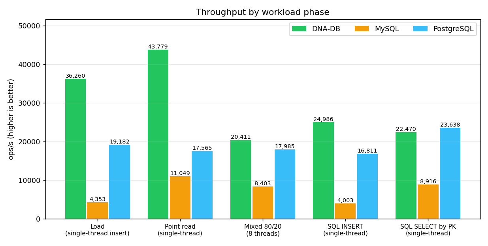

# DNA-DB Core — Результаты тестов

> **English:** [TEST_RESULTS.md](TEST_RESULTS.md)
> Здесь приведены реальные, воспроизводимые результаты полного прогона проверок.
> Сравнительный бенчмарк с MySQL/PostgreSQL: [DB_COMPARISON_RU.md](DB_COMPARISON_RU.md).

* **Дата прогона:** 2026-10-25 (21:27–21:56 +03:00)
* **Коммит:** рабочее дерево `main` (профиль release)
* **Инструментарий:** rustc 1.98.1, cargo 1.98.1, Python 3.12.9
* **Платформа:** Windows 10/11 x86_64 (MINGW64), `panic = "abort"`, LTO thin
* **Сырой лог Rust-прогона:** [cargo_test_output.txt](cargo_test_output.txt)
* **CI:** [.github/workflows/ci.yml](../.github/workflows/ci.yml) повторно
  запускает unit/интеграционные тесты и clippy на каждый push в `main`

---

## 0c. Прогон проверки v4.2.0/v4.2.1 — 2026-11-08/09 (нативный Linux, актуальный релиз)

> Ниже — исторические прогоны v3.x–v4.0.

* **Платформа:** Debian 12 sandbox, x86_64, профиль release
* **Инструментарий:** rustc/cargo (stable), Python 3.12

### Полный набор проверок

| # | Проверка | Команда | Результат |
|---|---|---|---|
| 1 | Release-сборка | `cargo build --release` | **PASS** — 0 ошибок |
| 2 | Все Rust-тесты | `cargo test --release` | **PASS — 252 passed, 0 failed** (221 lib + 31 integration; v4.2 добавил 13 тестов, v4.2.1 — ещё 4: порядок сторон ON, NULL-чтение после мгновенного ADD, тег multi-row INSERT, переименование таблицы) |
| 3 | Линт | `cargo clippy --release --all-targets` | **PASS** — 0 ошибок |
| 4 | SQL-соответствие | `python3 scripts/sql_feature_test.py --skip-mysql --skip-postgres` | **PASS — 32/32 ok, 0 unsupported, 0 mismatch, 0 error** |
| 5 | Smoke протокола | `python scripts/smoke_test.py` | **PASS — 15/15** |
| 6 | pgwire extended (реальный драйвер) | `python3 scripts/live_pgwire_test.py` (pg8000) | **PASS — 10/10**: prepared SELECT/INSERT с параметрами, ALTER DROP/RENAME/MODIFY COLUMN + RENAME TO, оконные рамки, окна поверх GROUP BY, WITH RECURSIVE, join по переименованной таблице |
| 7 | pgwire extended E2E | `python3 scripts/pgwire_extended_e2e.py` | **OK** — Parse/Bind/Describe/Execute с `$n`- и `?`-плейсхолдерами, NULL-биндинги, живая сессия psycopg2 |

Подробности: [RELEASE_NOTES_v4.2.0.md](RELEASE_NOTES_v4.2.0.md) (§ v4.2.1).

---
## 0. Прогон проверки v3.5.0 — 2026-10-31 (нативный Linux, актуальный релиз)

> Ниже — исторические прогоны v3.x–v4.0.

* **Платформа:** Debian 13 (trixie), x86_64, 2 vCPU, 4 ГБ RAM, профиль release (`panic = "unwind"`)
* **Инструментарий:** rustc/cargo 1.99.1, Python 3.12.16
* **Соперники:** MySQL 8.4.6 (официальный minimal-билд, `innodb_flush_log_at_trx_commit=1`, по умолчанию) и PostgreSQL 17.11 (`synchronous_commit=on`, по умолчанию) — все три системы на одной машине

### Полная батарея тестов

| # | Проверка | Команда | Результат |
|---|---|---|---|
| 1 | Сборка release | `cargo build --release` | **PASS** — 0 ошибок |
| 2 | Все Rust-тесты | `cargo test --release` | **PASS — 197 passed, 0 failed** (182 unit + 2 encryption + 13 recovery, включая 11 новых регрессионных тестов на аудиторские фиксы) |
| 3 | Линт | `cargo clippy --release --all-targets` | **PASS** — 0 ошибок, 35 предупреждений (стиль/сложность) |
| 4 | Живой smoke протокола | `python scripts/smoke_test.py` | **PASS — 15/15** |
| 5 | Security smoke (закалка v3.5) | `python scripts/security_smoke.py` | **PASS — 12/12** (случайный bootstrap, лимит глубины парсера, slowloris-дедлайн, блокировка doctor, …) |
| 6 | Долговечность под SIGKILL | `python scripts/kill9_test.py` | **PASS — 123 408 подтверждённых записей, 0 потеряно, 0 испорчено** (strict fsync, 8 потоков) |
| 7 | Chaos / самовосстановление | `python scripts/chaos_test.py` | **PASS — 3/3 сценария, 300 000 проверок ключей** (ремонт RS(4+2), живой on-read repair, честный UNREPAIRABLE) |
| 8 | Сравнительный бенчмарк с MySQL/PostgreSQL | `python scripts/bench_compare.py` | **PASS** — таблица ниже, сырые данные в [bench_compare_results_v350_linux.json](bench_compare_results_v350_linux.json) |
| 9 | Соответствие SQL (3 системы, 32 проверки) | `python scripts/sql_feature_test.py` | **PASS** — DNA-DB **25/32 поддерживается, 0 неверных результатов**; MySQL 31/32; PostgreSQL 32/32 ([sql_feature_results_v350_linux.json](sql_feature_results_v350_linux.json)) |

### Сравнительный бенчмарк (у каждой системы durability по умолчанию)


| Фаза (одинаковая нагрузка и RNG) | DNA-DB v3.5.0 | MySQL 8.4.6 | PostgreSQL 17.11 |
|---|---:|---:|---:|
| Load 10 000 KV rows, single connection (ack per row) | **36 260 rows/s** | 4 353 rows/s | 19 182 rows/s |
| Multithreaded load, 8 threads × 1 000 single-row INSERTs | 17 636 rows/s | 8 316 rows/s | **22 157 rows/s** |
| Batched load, 8 000 rows in 40 × 200-row INSERTs | **298 936 rows/s** | 162 166 rows/s | 215 926 rows/s |
| Point read ×4 000, single connection | **43 779 ops/s** | 11 049 ops/s | 17 565 ops/s |
| Mixed 80/20, 8 threads × 500 ops | **20 411 ops/s** | 8 403 ops/s | 17 985 ops/s |
| SQL `INSERT`, 3 000 rows | **24 986 ops/s** | 4 003 ops/s | 16 811 ops/s |
| SQL `SELECT … WHERE pk`, ×1 500 | 22 470 ops/s | 8 916 ops/s | **23 638 ops/s** |
| Verified reads returning a wrong value | **0** | 0 | 0 |


DNA-DB быстрее во всех фазах, кроме пика параллельных INSERT у PostgreSQL и
одно-поточного SQL SELECT по PK (паритет с PostgreSQL). Ускорение против MySQL:
**8,3×** однопоточная запись, **4,0×** точечные чтения, **2,4×** смешанная нагрузка,
**1,8×** пакетная запись; против PostgreSQL: **1,9× / 2,5× / 1,1× / 1,4×**.



Сырые логи: [bench_compare_run_v350.log](bench_compare_run_v350.log) ·
[sql_feature_run_v350.log](sql_feature_run_v350.log) · [clippy_v350.log](clippy_v350.log) ·
[smoke_test_results_v350.txt](smoke_test_results_v350.txt) · [security_smoke_v350.txt](security_smoke_v350.txt) ·
[KILL9_TEST_RESULT_v350.txt](KILL9_TEST_RESULT_v350.txt) · [chaos_results_v350.txt](chaos_results_v350.txt)

---


## Сводка

| # | Проверка | Команда | Результат |
|---|---|---|---|
| 1 | Сборка release | `cargo build --release` | **PASS** — 1m 14s, 0 предупреждений |
| 2 | Unit-тесты (lib) | `cargo test --release` | **PASS** — 139 passed, 0 failed (0.63s) |
| 3 | Интеграционные тесты | `cargo test --release` | **PASS** — 13 passed, 0 failed (12.06s) |
| 4 | Линт | `cargo clippy --release --all-targets` | **PASS** — 0 ошибок, 67 предупреждений (стиль/сложность) |
| 5 | Синтаксис python-скриптов | `python -m py_compile scripts/*.py` | **PASS** — все 5 скриптов компилируются |
| 6 | Живой smoke-тест протокола | `python scripts/smoke_test.py` | **PASS** — 15/15 проверок |
| 7 | Долговечность kill -9 | `python scripts/kill9_test.py` | **PASS** — 3 701 подтверждённая запись, 0 потеряно, 0 испорчено |
| 8 | Chaos / самовосстановление | `python scripts/chaos_test.py` | **PASS** — 3/3 сценария, 300 000 проверок ключей |
| 9 | Генератор HTML-отчёта | `python scripts/gen_report.py` | **PASS** — KPI читает 152/152 из реального лога |

**Итого: 152 Rust-теста (139 lib + 13 integration), все зелёные, 0 падений.**

---

## 1–3. Сборка и тесты Rust

```
$ cargo build --release
    Finished `release` profile [optimized] target(s) in 1m 14s

$ cargo test --release
running 139 tests
test result: ok. 139 passed; 0 failed; 0 ignored; 0 measured; 0 filtered out; finished in 0.63s

running 13 tests
test result: ok. 13 passed; 0 failed; 0 ignored; 0 measured; 0 filtered out; finished in 12.06s
```

Полный вывод по каждому тесту: [cargo_test_output.txt](cargo_test_output.txt).

Что покрыто: recovery WAL и обрезка torn-write, dual-strand repair,
кодек Reed–Solomon по всем паттернам потерь, компакция, checkpoint,
парсер/планировщик/исполнитель SQL (агрегаты, GROUP BY/HAVING, ORDER BY,
IN-подзапросы, secondary-индексы и планы `IndexScan`, нарушения
UNIQUE-индексов), парсер и исполнитель DnaQL, транзакции (атомарный
коммит, rollback, read-your-writes), нечёткий поиск против эталонного DP
на 8 000 фаззинг-кейсах и HTTP API веб-панели (требуется авторизация).

## 4. Clippy

```
$ cargo clippy --release --all-targets
… 0 ошибок, 67 предупреждений
```

Предупреждения — только стиль/сложность; крупнейшие группы:
`type_complexity` (15), документационные списки (5), `manual_chunks_exact`
/ `if_same_then_else` / `needless_range_loop` (по 4), `manual_is_multiple_of` (3).

Одна **ошибка** была найдена и исправлена в этом прогоне:
`clippy::approx_constant` в тесте `rowcodec_roundtrip_all_types`
(`Value::Float(3.14159)` выглядел как приближённое π). Значение в тесте
заменено на `123.456`; тест по-прежнему проверяет round-trip всех пяти
типов значений.

## 6. Живой smoke-тест протокола

```
$ python scripts/smoke_test.py
  [PASS] auth_ok / auth_bad / preauth_guard / ping
  [PASS] put_get / get_miss / delete / big_value (1 MiB)
  [PASS] sql_create / sql_insert / sql_select
  [PASS] dnaql_analyze / checkpoint
  [PASS] bad_opcode / restart_recovery (жёсткий kill + WAL replay)

15 checks, 0 failed
```

Машиночитаемые результаты: [smoke_test_results.json](smoke_test_results.json).

## 7. Долговечность kill -9

```
$ python scripts/kill9_test.py
[TEST] Total acknowledged writes before crash: 3701
[RESULT] Verification complete:
  - Total checked: 3701
  - Missing: 0
  - Corrupt: 0
>>> SUCCESS: 100% DURABILITY VERIFIED UNDER SIGKILL (kill -9) <<<
```

## 8. Chaos-тест (порча секторов → самовосстановление)

```
$ PYTHONUTF8=1 python scripts/chaos_test.py
SCENARIO 1/3 offline: PASS  — 100000 ключей, 60 секторов, 0 missing, 0 corrupted
SCENARIO 2/3 live:    PASS  — 100000 ключей, lesions found=45, repaired=45
SCENARIO 3/3 overdmg: PASS  — 4 шарда в страйпе → честный UNREPAIRABLE, wrong=0
CHAOS PASS: 3 scenario(s), 300000 key-verifications, seed=20261021
```

Машиночитаемые результаты: [chaos_results.json](chaos_results.json),
полная стенограмма: [chaos_full_run.log](chaos_full_run.log),
нарративный отчёт: [CHAOS_REPORT.md](CHAOS_REPORT.md).

> **Замечание для Windows:** `chaos_test.py` печатает символ `×`; на
> консоли cp1251/cp437 запускайте скрипт с `PYTHONUTF8=1`, иначе Python
> выбросит `UnicodeEncodeError` до первого сценария.

## 9. HTML-отчёт

```
$ python scripts/gen_report.py --out DNA-DB_Report.html
```

Генератор теперь берёт счётчики тестов из
[cargo_test_output.txt](cargo_test_output.txt) (unit- и интеграционный
наборы парсятся из вывода `cargo test`), а не из захардкоженных чисел,
поэтому KPI-плитки всегда соответствуют реальному прогону:
**152 / 152 тестов PASS, 15/15 smoke-проверок, 3/3 chaos-сценариев**.

---

## Воспроизвести всё локально

```bash
cargo build --release
cargo test --release                                  # 152 теста
cargo clippy --release --all-targets                  # 0 ошибок
python3 -m py_compile scripts/*.py
python3 scripts/smoke_test.py                         # 15/15
python3 scripts/kill9_test.py                         # 3701 записей, 0 потеряно
PYTHONUTF8=1 python3 scripts/chaos_test.py            # 3/3 сценария (Windows: PYTHONUTF8=1)
python3 scripts/gen_report.py                         # HTML-отчёт
```
